# hiRobot: A Unified Interface Layer for Controlling Diverse Robots from VLA Models and Agents

<div align="center">

**Author:** [The Humanoid Intelligence Team](https://humanoidintelligence.github.io)

[OpenMOSS Group](https://openmoss.ai) / [Shanghai Innovation Institute](https://www.sii.edu.cn/) / [Fudan University](https://www.fudan.edu.cn/en/)

**English** | [简体中文](./README.zh-CN.md) · **Docs:** [Supported robots](docs/supported_robots.md) · [Setup guides](docs/setup/README.md) · [API reference](docs/api.md) · [Changelog](CHANGELOG.md) · [Contributing](CONTRIBUTING.md)

<!-- hardware-gallery:start -->

<table>
<tr><td align="center"><a href="docs/supported_robots.md">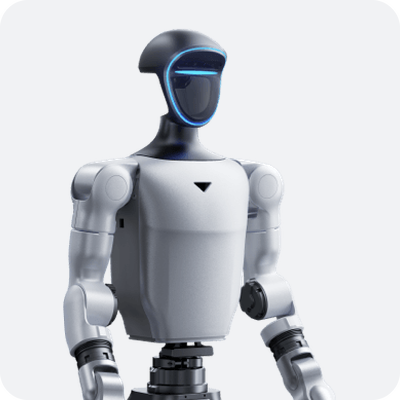</a><br><sub>Unitree G1</sub></td><td align="center"><a href="docs/supported_robots.md">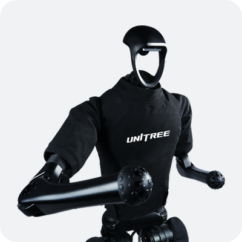</a><br><sub>Unitree H1</sub></td><td align="center"><a href="docs/supported_robots.md">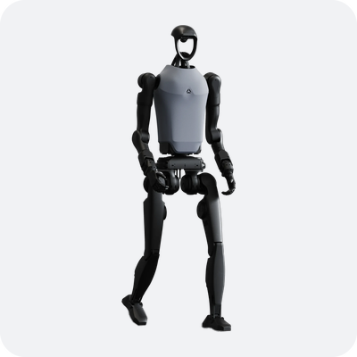</a><br><sub>Unitree H1-2</sub></td><td align="center"><a href="docs/supported_robots.md">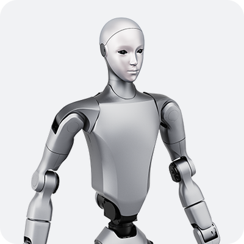</a><br><sub>Unitree H2</sub></td><td align="center"><a href="docs/supported_robots.md">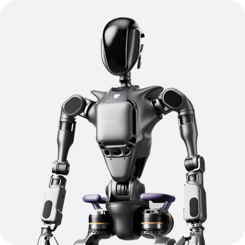</a><br><sub>Fourier GR1</sub></td><td align="center"><a href="docs/supported_robots.md">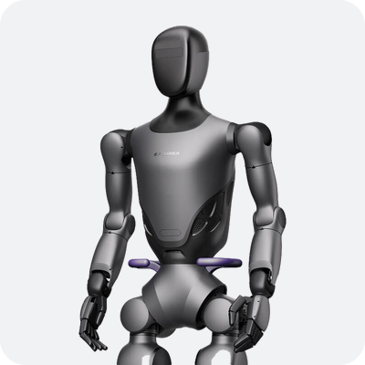</a><br><sub>Fourier GR2</sub></td><td align="center"><a href="docs/supported_robots.md">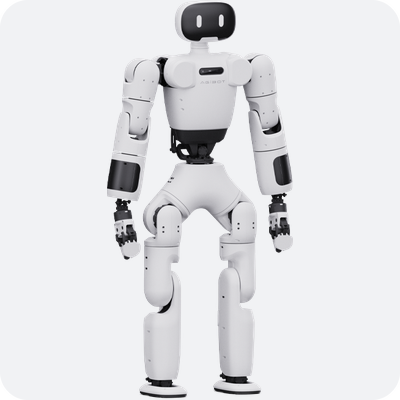</a><br><sub>AgiBot X1</sub></td></tr>
<tr><td align="center"><a href="docs/supported_robots.md">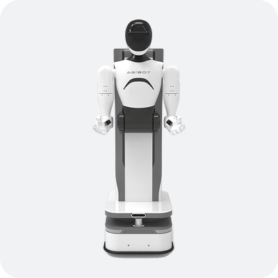</a><br><sub>AgiBot G1</sub></td><td align="center"><a href="docs/supported_robots.md">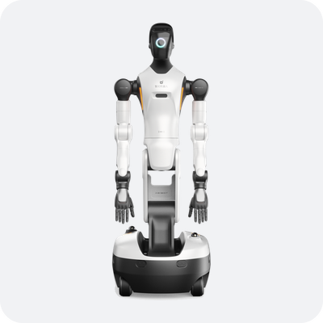</a><br><sub>AgiBot G2</sub></td><td align="center"><a href="docs/supported_robots.md">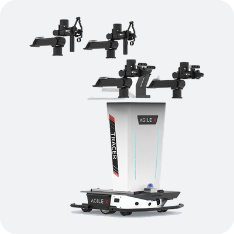</a><br><sub>AgileX ALOHA</sub></td><td align="center"><a href="docs/supported_robots.md">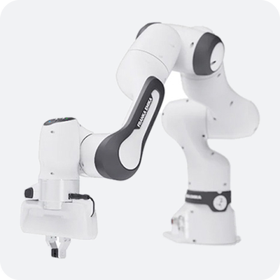</a><br><sub>Franka FR3</sub></td><td align="center"><a href="docs/supported_robots.md">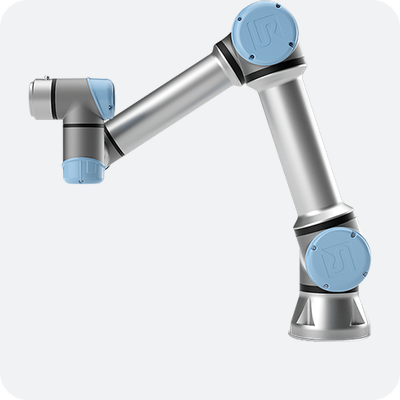</a><br><sub>UR5e</sub></td><td align="center"><a href="docs/supported_robots.md">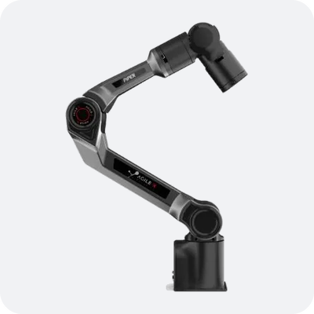</a><br><sub>AgileX PiPER</sub></td><td align="center"><a href="docs/supported_robots.md">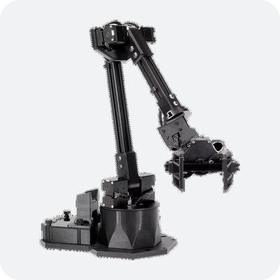</a><br><sub>WidowX 250S</sub></td></tr>
<tr><td align="center"><a href="docs/supported_robots.md">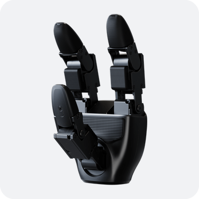</a><br><sub>Unitree Dex3-1</sub></td><td align="center"><a href="docs/supported_robots.md">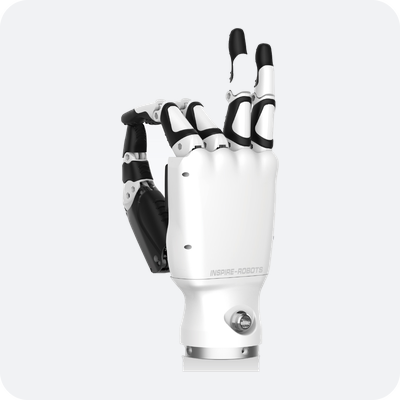</a><br><sub>Inspire RH56DFX</sub></td><td align="center"><a href="docs/supported_robots.md">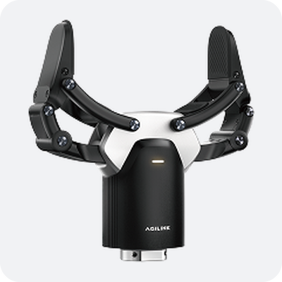</a><br><sub>AgiBot OmniPicker</sub></td><td align="center"><a href="docs/supported_robots.md">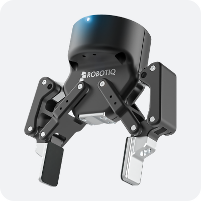</a><br><sub>Robotiq 2F-85</sub></td><td align="center"><a href="docs/supported_robots.md">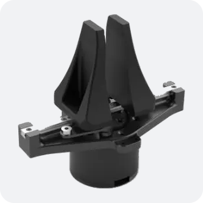</a><br><sub>AgileX PiPER gripper</sub></td><td align="center"><a href="docs/supported_robots.md">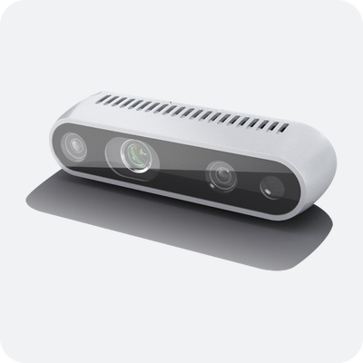</a><br><sub>RealSense D435i</sub></td><td align="center"><a href="docs/supported_robots.md">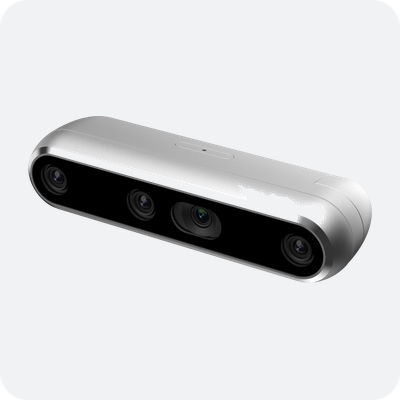</a><br><sub>RealSense D457</sub></td></tr>
<tr><td align="center"><a href="docs/supported_robots.md">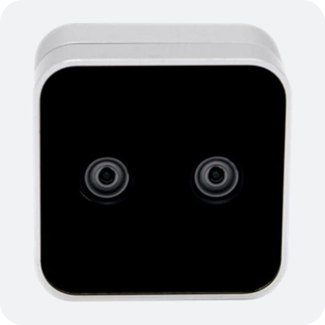</a><br><sub>RealSense D405</sub></td><td align="center"><a href="docs/supported_robots.md">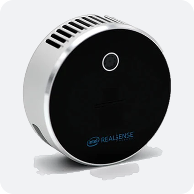</a><br><sub>RealSense L515</sub></td><td align="center"><a href="docs/supported_robots.md">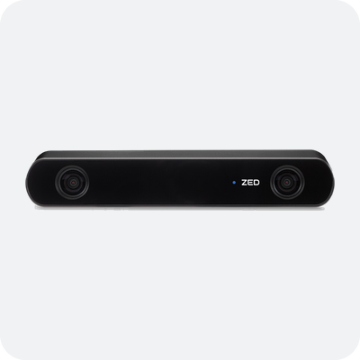</a><br><sub>ZED 2i / ZED Mini</sub></td><td align="center"><a href="docs/supported_robots.md">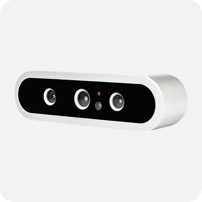</a><br><sub>Orbbec Dabai DC1</sub></td></tr>
</table>

<!-- hardware-gallery:end -->

</div>

<!-- toc -->

<details>
<summary><b>Contents</b></summary>

- [Introduction](#introduction)
- [Supported robots](#supported-robots)
- [Quick start](#quick-start)
  - [Simulation](#simulation)
  - [Real robot: Unitree G1](#real-robot-unitree-g1)
  - [Several robots as one](#several-robots-as-one)
- [Architecture](#architecture)
- [Repository structure](#repository-structure)
- [Add a new robot](#add-a-new-robot)
- [Contact](#contact)
- [Citation](#citation)
- [License](#license)

</details>

<!-- /toc -->

## Introduction

hiRobot gives models and agents a single, consistent way to observe and command
a robot — **humanoid or arm, in simulation or on real hardware** — regardless of
the vendor SDK underneath. It standardizes the embodiment I/O (joints, optional
floating base, optional end-effectors, cameras, control rate) and the robot-driver
contract, so control code written once runs across different robots without
rewrites.

Robots come in many flavors: ~30 DoF humanoids with a floating base (Unitree,
Fourier GRx, AgiBot X1), dual arms on a wheeled base (AgiBot G1) and fixed-base
arms with Cartesian control (Franka, UR).
Wiring a model or agent to each one usually means bespoke glue per robot and per
SDK. hiRobot standardizes that glue:

- **One interface, many robots** — write control logic against the `Robot`
  contract and run it on any robot that provides a driver. Each robot's joints
  (by name), base, and end-effectors are described in config, so the same
  policy can target different robots. An assembly config drives several complete
  robots (different vendors, each with its own hands, gate and whole-body
  control) plus scene cameras as one `Robot`, each placed in the shared frame,
  so a bimanual VLA or an agent controls them without new code.
- **Sim and real, symmetric** — simulation and hardware are just different
  drivers behind the same contract, selected by one config field. The MuJoCo
  robot runs on its own for debugging without hardware, or starts from a real
  robot's measured pose to rehearse a motion before it is sent. Simulated
  benchmark environments plug in as drivers behind the same contract, so code
  evaluated in simulation runs unchanged on the robot.
- **VLA agnostic** — hiRobot's `Observation` / `ActionChunk` types are what a
  VLA reads and produces, whichever model it is. Swapping one VLA for another
  (GR00T, π0.5, StarVLA) changes the hiVLA server hiAgent points at, not the
  robot code.
- **Agent friendly** — the interface is easy for an agent to call as tools:
  `Robot.action_modes` lists the control modes a driver accepts, `get_status`
  reports battery, temperatures and joint faults, `list_skills()` lists what
  the robot does by name (walk, gestures), each with a description and a JSON
  Schema for its arguments, and
  `SafetyGate` checks every command, so a refused action raises `SafetyError`
  instead of reaching the motors. [docs/api.md](docs/api.md) documents every
  call with its arguments and failure modes.
- **Step-by-step deployment docs** — real-robot deployment involves many
  details a newcomer can't guess, so each supported robot gets a setup guide
  covering SDK install, network setup, power-on and safety, connection
  parameters, the first control loop, and common pitfalls.
- **Decoupled by design** — each part has its own contract and registry
  (body, end-effector, camera, audio), and each driver lives in its own
  `drivers/<part>/<SDK vendor>/<SDK or protocol>/` directory with a manifest
  of the SDK it needs, a fake SDK and a shared contract test. A robot config is
  an `assembly:` tree that references one file per device, and controllers such as
  whole-body control plug in as `layers:` from their own packages. A new model
  on a supported SDK is configs only; a new SDK is one driver directory and its
  tests, with no change to the core.

> [!NOTE]
> **Companion projects.** [hiWBC](https://github.com/humanoidintelligence/hiWBC)
> handles whole-body balance and locomotion beneath the robot interface,
> [hiVLA](https://github.com/humanoidintelligence/hiVLA) (the motor cortex) serves
> VLA models over the network, and
> [hiAgent](https://github.com/humanoidintelligence/hiAgent), the agentic operating
> layer, drives the robot from above. The text below uses them as examples;
> hiRobot works on its own and imports none of them.

> [!WARNING]
> **Status — early development.** APIs are unstable and subject to change.
>
> **Safety on real robots.** A robot under software control can injure people and
> damage itself. Read this repository carefully before running it on hardware,
> including the [setup guide](docs/setup/README.md) for your robot.
> Debug in simulation until it works, then move to the real robot step by step:
> read-only first, then the robot hung on a gantry at low gains, with an e-stop
> within reach and nobody inside the robot's reach.

## Supported robots

The real robots (bodies, mobile bases, end effectors, cameras), with their
configs, drivers, vendor SDKs, setup guides and hardware checks, and the sim
robots are listed in [docs/supported_robots.md](docs/supported_robots.md).

## Quick start

The core install is light (numpy, pydantic, pyyaml); extras add what a given
driver needs:

```bash
git clone https://github.com/humanoidintelligence/hiRobot.git && cd hiRobot
pip install -e .                 # core: interface, toy driver, safety gate
# extras: sim (MuJoCo robot) · camera · video · audio · dev
```

Inspect the embodiment a config describes (no robot, no GPU):

```bash
hirobot info --config unitree_g1   # a humanoid
hirobot info --config ur_ur5e      # a fixed-base arm
```

### Simulation

Debug control code on a MuJoCo G1 first. Install the extra and fetch the G1
model ([commands](docs/setup/unitree.md#5-mujoco-g1-optional)), then open it in
the viewer:

```bash
pip install -e '.[sim]'
hirobot sim unitree_g1_mujoco --viewer
```

The basic control loop: read an observation, send an action, and hold at the
end. This one bends the right elbow to 1 rad over 2 s:

```python
from hirobot import Action, ControlMode, make_robot

robot = make_robot("unitree_g1_mujoco")   # pelvis welded, like the robot on its gantry
robot.connect()
robot.reset()
elbow = robot.embodiment.joint_names.index("right_elbow")

for step in range(100):                   # 2 s at control_hz = 50
    obs = robot.get_observation()         # joint_pos, base IMU, images["head"]
    target = obs.joint_pos.copy()
    target[elbow] = min(target[elbow] + 0.01, 1.0)
    robot.send_action(Action(mode=ControlMode.POSITION, joint_target=target))
robot.hold()
robot.disconnect()
```

A simulator steps once per `send_action`, so the loop needs no timer; on a real
robot, pace it at `robot.embodiment.control_hz`. The same code runs on the real
G1 once the config changes.

### Real robot: Unitree G1

From a fresh clone to a first motion on a G1: lift the right forearm to
horizontal and back. The full procedure, with what to check at each step and
the results of a real run, is in
[the Unitree setup guide](docs/setup/unitree.md#6-first-motion-step-by-step-g1-elbow).

**1. Install the SDK and connect.** Install
[unitree_sdk2_python](https://github.com/unitreerobotics/unitree_sdk2_python),
plug the robot in over Ethernet, and put the host NIC on `192.168.123.x`
([network](docs/setup/unitree.md#2-network)). For the rehearsal in step 4, also
`pip install -e '.[sim]'` and fetch the G1 model
([MuJoCo setup](docs/setup/unitree.md#5-mujoco-g1-optional)).

**2. Write a local config.** Start it with `defaults: [unitree_g1]`, so the
joints, camera and audio come from the built-in config, then override the `body`
part's driver (`type: unitree_sdk2`, the network card, per-joint gains).
[`examples/unitree_g1_real.yaml`](examples/unitree_g1_real.yaml) has working G1
gains; [`examples/`](examples/README.md) also has a read-only version.

**3. Read the robot (read-only).** Joint angles, IMU, temperatures, and whether
a built-in motion service owns the command topic:

```bash
python scripts/unitree_setup.py status --config my_g1.yaml --iface eth0
python scripts/unitree_estop.py --iface eth0     # second terminal: software e-stop
```

**4. Rehearse in simulation (read-only).** The real robot is opened read-only,
its pose is read once, and the move runs on `unitree_g1_mujoco` started from
that pose. Nothing is sent to the robot:

```bash
python examples/rehearse_in_sim.py my_g1.yaml unitree_g1_mujoco \
    --body network_interface=eth0 --joint right_elbow --target 0.0
```

**5. Run it on the robot.** Hang the robot with its feet off the ground and keep
the e-stop in hand. Keep the gains low for the first runs; the ones in
`examples/unitree_g1_real.yaml` are:

```bash
python scripts/unitree_setup.py move --config my_g1.yaml --iface eth0 \
    --joint right_elbow --target 0.0 --ramp 3 --release-motion-mode
```

The move aborts to damping if any joint strays more than 0.3 rad, and always
ends in damping. `restore` hands control back to the built-in service.

Other robots follow their own
guides: [overview](docs/setup/README.md) ·
[Fourier GR1](docs/setup/fourier.md) ·
[AgiBot G1](docs/setup/agibot_g1.md) · [AgiBot X1](docs/setup/agibot_x1.md) · [Franka FR3](docs/setup/franka.md) ·
[Universal Robots UR5e](docs/setup/ur.md) · [AgileX PiPER](docs/setup/agilex_piper.md).

### Several robots as one

An `assembly:` config with several parts builds one `Robot` that drives them
all: each part is a whole single-robot config, and the assembly is itself a
`Robot`, so the loop above drives it unchanged. The built-in `franka_ur5e_dual`
runs on toy drivers:

```python
from hirobot import Action, ControlMode, make_robot

robot = make_robot("franka_ur5e_dual")          # Franka FR3 + UR5e + a scene camera
robot.connect()
robot.reset()
obs = robot.get_observation()                    # joints concatenated: left/..., right/...
left = robot.part("left").get_observation()      # one part, in its own names
robot.send_action(Action(parts={                 # one sub-action per part, each in its own mode
    "left": Action(mode=ControlMode.POSITION, joint_target=left.joint_pos + 0.1),
}))                                              # "right" is not named and keeps its target
robot.disconnect()
```

For hardware, each arm gets its driver and address as overrides of its body
(`left/body`, `right/body`)
([`examples/franka_ur5e_dual_real.yaml`](examples/franka_ur5e_dual_real.yaml)).
Every piece of an action is checked before anything is sent, and a part that
fails puts the whole robot on hold. Flat actions, placement, world frames and
naming rules are in [docs/api.md](docs/api.md#robotassembly).

## Architecture

![hiRobot architecture. Inside hiRobot: make_robot reads a config into an Embodiment and builds a stack, outermost first: the Robot contract (Observation / Action), the command arbiter (leases, priorities, envelopes, audit), optional layers, the SafetyGate under the layers (limits, step, battery, temperature, simulation check), and the RobotAssembly tree (one node per robot, each joining a body, hands, cameras and audio; a node with child parts drives several robots as one, checks every part before sending, runs an optional collision check, holds all on error) down to the drivers; estop() goes to the driver first, then each layer (real robots, simulators, hands, cameras, audio) that talk to vendor SDKs and simulators. Utilities beside it: DofMap, Kinematics, transforms. Around it: hiAgent and hiVLA above, exchanging observations and action chunks over the network, with actions going down to the Robot and observations coming back up; hiWBC plugs in as a layer. All companions are optional.](assets/architecture.png)

hiRobot owns the robot I/O. `make_robot` reads a config (a tree of device files
turned into an `Embodiment`) and builds a stack of `Robot`s. From the bottom
up: a driver talks to the vendor SDK or simulator; one `RobotAssembly` joins
the body with its hands, cameras and audio; the hardware `SafetyGate` sits on
that assembly; optional layers (plugins registered with `register_layer`, such
as hiWBC) wrap it; and a command arbiter on the outermost robot decides who may
command the stack. A `RobotAssembly` can also have child parts, so several such
robots are driven as one: the whole tree is a single `Robot` under one gate and
arbiter, and each part keeps its own gate, layers and lease. Every command
leaves through `Robot.send_action`, which runs the gate before the driver
touches the hardware and raises `SafetyError` on a refusal. Because the hardware
gate is under the layers, the joint targets a layer computes are checked too,
and no caller can skip it.

The gate checks shape, DoF count and finiteness, and optionally joint limits,
the step from the last target, the distance from the measured pose, battery and
temperature, and a short MuJoCo simulation of the command (all set in the
config's `safety:` section). `estop()` reaches the driver at the bottom first,
from any thread, before each layer stops its own work. A program holds the
command stream with a lease, `robot.claim(name)`; a higher priority (teleop
takeover) preempts it, and a lease can carry a stricter safety envelope. A
velocity command that is not refreshed within `command_timeout_s` stops.
`hirobot view` shows a real robot's pose in MuJoCo from outside the stack,
opened read-only.

The companions use the same `Robot` from outside. hiWBC registers a layer
(`layers: [{type: wbc, ...}]` in a config) that sits on the humanoid's body and
turns base velocity, motion clips and motion latents into balanced joint
targets every tick; the layer is itself a `Robot`, so callers above it do not
change. hiAgent runs the control loop and calls the `Robot` in-process: it reads
an `Observation`, sends it to a model served by hiVLA, and sends the returned
action chunk to the robot one `Action` at a time.

Core concepts:

| Concept | Responsibility |
| --- | --- |
| `Embodiment` | What a robot looks like to a policy: joints (by name, in the SDK's order), `floating_base`, end-effectors, cameras, microphones / speakers, `control_hz`. Built from a config (a device file or an `assembly:` tree). |
| `Observation` / `Action` / `ActionChunk` | Typed I/O. Joint space (universal) + optional base (humanoids) + optional task space (arms) + images. `ControlMode` selects joint, Cartesian, base velocity or motion targets; an `ActionChunk` is several predicted steps. |
| `Robot` | The contract every driver, simulator and wrapper implements: `connect` / `reset` / `get_observation` / `send_action` / `hold` / `set_gains` / `get_status` / `disconnect`, plus `action_modes` (the modes it accepts) and skills, `list_skills` / `run_skill` / `stop_skill` (motions the robot's controller or a layer runs, started by name). Drivers implement `_send_action`; `send_action` runs the gate first. [Details](docs/api.md#robot). |
| `SafetyGate` / `SafetyError` | Checks every action inside `send_action`: shape, DoF count and finiteness always; joint limits, step and tracking-error limits, battery and temperature, and a MuJoCo simulation check when configured. A refusal raises `SafetyError` (or clamps, with `clamp: true`). Set by the config's `safety:` section. [Details](docs/api.md#safetygate). |
| `CommandArbiter` / `CommandLease` | `robot.claim(name, priority)` gives one program the command stream; others get `RobotBusyError`, a higher priority (`TAKEOVER` > `LAYER_SKILL` > `CALLER`) preempts. A lease can carry a stricter `envelope`; claims, preemptions and refusals are kept in an audit (`robot.command_events()`). With nobody holding a lease, every caller may command. [Details](docs/api.md#command-arbiter). |
| `Layer` | Base class of a layer: a `Robot` wrapping the stack below (`inner`, public API only). It may offer layer skills (`run_layer_skill`). [Writing a layer](docs/api.md#writing-a-layer). |
| `make_robot` / registries | Builds the stack from a config name or path. Drivers and layers are found by name in registries (`register_body`, `register_end_effector`, `register_camera`, `register_audio`, `register_layer`); packages add their own through the `hirobot.drivers` entry point. |
| `RobotAssembly` | The node `make_robot` builds from a config: it attaches devices (cameras, hands, audio) to a body, or, with child parts, drives several complete robots as one `Robot` in a shared frame. [Details](docs/api.md#robotassembly). |
| `DofMap` / `Kinematics` | Reorder joint vectors by name between layouts; forward kinematics of an MJCF model. |

## Repository structure

```
hiRobot/
├── src/hirobot/
│   ├── __init__.py          # the public API: make_robot, Robot, Observation, Action, ...
│   ├── cli.py               # `hirobot info`, `configs`, `sim`, `view`
│   ├── testing.py           # assert_layer_uses_public_api, for layer packages
│   ├── core/                # embodiment, types, robot + robot_skills, dof, stamps
│   ├── devices/             # end_effector, camera, audio: contracts and registries
│   ├── geometry/            # transforms, kinematics, collision
│   ├── loading/             # config, tree, layout, legacy, build, registry, sdk
│   ├── assembly/            # RobotAssembly + parts, node, part_layers
│   ├── control/             # safety (gate), arbiter, layer, watchdog
│   ├── sim/                 # sim_world, sim_check, check_sim, view
│   ├── configs/             # built-in configs (installed with the package)
│   │   ├── body/ end_effector/ camera/ microphone/ speaker/   # one device file per model, by vendor
│   │   └── robots/          # whole robots and multi-robot assemblies (franka_ur5e_dual); *_mujoco add sim:
│   └── drivers/             # <part>/<SDK vendor>/<SDK or protocol>/{driver.py, manifest.yaml}
│       ├── body/            # unitree/sdk2, fourier/grx, agibot/aimrt, franka/droid, ur/rtde, agilex/piper_sdk
│       ├── end_effector/    # hands: unitree/sdk2_handcmd (Dex3-1), unitree/sdk2_motorcmds, inspire/sdkpy
│       ├── camera/          # unitree/sdk2_videohub, unitree/image_server; generic/{video_file,array}
│       ├── audio/           # unitree/sdk2_voice; generic/{wav,sounddevice}
│       ├── sim/             # toy/ (`toy`), mujoco/ (`mujoco`)
│       └── _sdk/            # code shared inside one SDK (Unitree DDS init, once per process)
├── examples/                # configs to copy: real robot, read_only, multi-robot; rehearse_in_sim.py
├── scripts/
│   ├── unitree_setup.py          # status / hold / move / restore on a Unitree robot
│   ├── unitree_estop.py          # software e-stop (damping on Ctrl-C)
│   ├── dex3_setup.py             # status / wiggle on the G1 Dex3 hands (body never commanded)
│   ├── inspire_serial_to_dds.py  # H1 Inspire hands: RS485 serial <-> DDS bridge, runs on PC2
│   ├── inspire_hand_demo.py      # open the Inspire hands slowly, then return (body untouched)
│   └── camera_image_server.py    # serve a camera as JPEG over ZeroMQ (image_server format)
├── docs/
│   ├── api.md               # public API reference (api.zh-CN.md: Chinese)
│   ├── supported_robots.md  # real and sim robots: photos, configs, drivers, hardware checks
│   └── setup/               # per-robot hardware setup guides (<robot>.zh-CN.md: Chinese)
├── tests/                   # pytest suite; simulators and SDKs are faked, no GPU needed
│   ├── drivers/             # mirrors src/hirobot/drivers/: fake_sdk.py + test_contract.py per SDK
│   └── data/                # expanded_configs.json: snapshot of every built-in robot config
├── assets/                  # README and docs images; hardware/: robot photos
└── CHANGELOG.md             # changes in each release (CHANGELOG.zh-CN.md: Chinese)
```

What changed in each release is in [CHANGELOG.md](CHANGELOG.md).

## Add a new robot

> [!TIP]
> **Pull requests are welcome.** A new robot, hand, camera or SDK version, a
> hardware check of a driver not yet marked ✅, or a fix to a setup guide each
> brings robot control a step closer to one shared interface. Before opening a
> pull request, read [CONTRIBUTING.md](CONTRIBUTING.md): what each kind of change
> needs, hardware checks and reviewers.

A robot is supported in two layers: **configs** (its joint layout and parts) and
a **driver** (the hardware link). Code is organized by how it talks to the
hardware: `drivers/<part>/<SDK vendor>/<SDK or protocol>/`, named after the SDK,
not the product. Models live in configs: `configs/<part>/<vendor>/<model>.yaml`
says which driver to use. One SDK usually covers many models, so most new
robots need only configs.

| Case | What to add | Example |
|---|---|---|
| New model, same SDK and protocol | Configs only: `body/<vendor>/<model>.yaml` and `robots/<name>.yaml` | Unitree H2D: `body/unitree/h2d.yaml` |
| New version of a supported SDK | A `verified` entry in the driver's `manifest.yaml` once it ran on hardware; a fake-SDK test if behavior changed | G1 + Dex3 on `unitree_sdk2py` 1.1 |
| New SDK or protocol | A new SDK directory with `driver.py`, `manifest.yaml`, a new registered name, and `tests/drivers/.../{fake_sdk,test_contract}.py` | Fourier Aurora, AgiBot OmniHand |
| SDK generation break (message layout, control or gain semantics change) | A new directory under the same vendor (`sdk3/`) and a new name (`unitree_sdk3`) | |

Registered names are `<vendor>_<SDK or protocol>` (`unitree_sdk2`, `fourier_grx`).
A released name never changes meaning, so updating hiRobot cannot quietly swap
the driver a real robot runs.

**Configs.** Write one device file per model under `src/hirobot/configs/`
(`body/`, `end_effector/`, `camera/`, `microphone/`, `speaker/`): a `body` file
lists its joints by name in the SDK's order and sets `floating_base`,
`control_hz` and its `driver`. Assemble the whole robot in `robots/<name>.yaml`
as an `assembly:` that references those files under `parts:` and places them with
`placement:`. Check the result with `hirobot info --config <name> --resolved`.

**A driver.** Subclass `Robot` (or `EndEffectorDriver`, `CameraDriver`,
`MicrophoneDriver` / `SpeakerDriver`), map `Observation` / `Action` onto the SDK's
reads and commands, and register it (`@register_body("<vendor>_<sdk>")`). Import
the SDK inside `connect()` after `require_sdk(__package__)`, so `hirobot` imports
without it and a missing or old SDK gives a clear error. `manifest.yaml` lists
the SDK (`distribution`, `minimum`, `install`) and starts with `verified: []`.
Report `base_orientation` as `[x, y, z, w]`.

**Tests.** Write a fake of the SDK calls the driver makes in
`tests/drivers/<part>/<vendor>/<sdk>/fake_sdk.py`, and run the shared checks
from `tests/drivers/contract.py` against it in `test_contract.py`
(`check_robot`, `check_hand`, `check_camera`, `check_microphone`,
`check_speaker`). They cover the registry, the manifest, connect / read /
command / disconnect, per-joint shapes, the quaternion and the safety gate.
`tests/drivers/test_coverage.py` fails while a registered driver has none.
Hardware runs cannot go in CI: record them as `verified` entries
(model, SDK version, date).

**Outside the repository.** A separate package can register drivers through the
`hirobot.drivers` entry-point group and release on its own SDK's schedule;
user configs stay the same.

## Contact

- [Peng Li](https://artpli.github.io): pengli.ds [at] gmail.com

## Citation

If you use hiRobot in your research, please cite it:

```bibtex
@misc{hirobot,
  title  = {hiRobot: A Unified Interface Layer for Controlling Diverse Robots from VLA Models and Agents},
  author = {Li, Peng and Zhang, Yifei and Zhuang, Zihan and Dong, Yi and Gui, Tao and Qiu, Xipeng},
  year   = {2026},
  url    = {https://github.com/humanoidintelligence/hiRobot}
}
```

## License

[Apache License 2.0](LICENSE). See [LICENSE](LICENSE) for the full terms.
