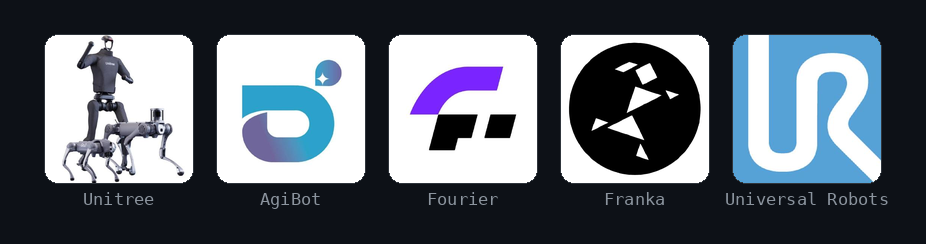

# hiRobot: A Unified Interface Layer for Controlling Diverse Robots from VLA Models and Agents

<div align="center">



**Author:** [The Humanoid Intelligence Team](https://humanoidintelligence.github.io) from [OpenMOSS Group](https://openmoss.ai) / [Shanghai Innovation Institute](https://www.sii.edu.cn/) / [Fudan University](https://www.fudan.edu.cn/en/)

[English](./README.md) | 简体中文

</div>

<!-- toc -->

<details>
<summary><b>目录</b></summary>

- [简介](#简介)
- [架构](#架构)
- [仓库结构](#仓库结构)
- [支持的机器人](#支持的机器人)
  - [真机](#真机)
    - [机器人本体](#机器人本体)
    - [末端执行器](#末端执行器)
    - [摄像头](#摄像头)
    - [移动底盘](#移动底盘)
  - [仿真机器人](#仿真机器人)
- [快速开始](#快速开始)
  - [仿真](#仿真)
  - [真机：Unitree G1](#真机unitree-g1)
  - [多台机器人作为一个](#多台机器人作为一个)
- [添加新机器人](#添加新机器人)
- [联系方式](#联系方式)
- [引用](#引用)
- [许可证](#许可证)

</details>

<!-- /toc -->

## 简介

hiRobot 为模型和 agent 提供一种统一、一致的方式来观测和控制机器人（**人形或机械臂，仿真或真机**），
不论底层是哪家厂商的 SDK。它统一了 embodiment（本体描述）的输入输出（关节、可选的浮动基座、
可选的末端执行器、摄像头、控制频率）和机器人驱动的接口约定，所以控制代码写一次，就能在不同的
机器人上运行，无需重写。

机器人种类繁多：带浮动基座、约 30 自由度的人形机器人（Unitree、Fourier GRx、AgiBot X1），
装在轮式底盘上的双臂（AgiBot G1），以及支持笛卡尔控制的固定基座机械臂（Franka、UR）。
把模型或 agent 接到每一台机器人上，通常要为每种机器人、每个 SDK 单独写胶水代码。
hiRobot 把这层胶水统一起来：

- **一个接口，多种机器人**：针对 `Robot` 接口约定编写控制逻辑，就能在任何提供了驱动的机器人上运行。
  每台机器人的关节（按名称）、基座和末端执行器都在配置中描述，所以同一个 policy 可以面向不同的机器人。
  `RobotGroup` 把几台完整的机器人（来自不同厂商，各自带有自己的手、安全门和全身控制）加上场景摄像头
  当作一个 `Robot` 来驱动，并放在共享的世界坐标系中，所以双臂 VLA 或 agent 无需新代码就能控制它们。
- **仿真与真机对称**：仿真和硬件只是同一接口约定背后的不同驱动，由配置中的一个字段选择。
  MuJoCo 机器人可以单独运行，无需硬件即可调试；也可以作为数字孪生在真机旁运行，镜像真机的实测状态
  （`mirror`），或从真机当前的姿态出发预演一个动作（`shadow`）。仿真基准环境以驱动的形式接入同一接口约定，
  所以在仿真中评测过的代码无需修改就能在机器人上运行。
- **与 VLA 无关**：无论是哪个模型，VLA 读取和产出的都是 hiRobot 的 `Observation` / `ActionChunk` 类型。
  把一个 VLA 换成另一个（GR00T、π0.5、StarVLA），改变的是 hiAgent 指向的 hiVLA 服务，而不是机器人代码。
- **对 agent 友好**：接口便于 agent 作为工具调用：`Robot.action_modes` 列出驱动接受的控制模式，
  `get_status` 报告电量、温度和关节故障，机器人 skill（行走、手势）附带说明和参数的 JSON Schema，
  `SafetyGate` 检查每一条命令，所以被拒绝的动作会抛出 `SafetyError`，而不会到达电机。
  [docs/api.zh-CN.md](docs/api.zh-CN.md) 记录了每个调用的参数和失败方式。
- **分步部署文档**：真机部署涉及许多新手猜不到的细节，所以每台支持的机器人都有一份设置指南，
  涵盖 SDK 安装、网络设置、上电与安全、连接参数、第一个控制循环和常见的坑。
- **解耦设计**：每个部件（本体、手、摄像头、音频）都有自己的接口约定和注册表，每个驱动都放在自己的
  `drivers/<part>/<SDK vendor>/<SDK or protocol>/` 目录中，附带所需 SDK 的 manifest、一个假 SDK
  和一个共享的接口约定测试。配置由每个部件一个文件、通过 `defaults:` 组合而成，全身控制等控制器
  则从各自的包以 `layers:` 的形式接入。在已支持的 SDK 上新增型号只需要配置；新增 SDK 只需要
  一个驱动目录及其测试，核心无需改动。

> [!NOTE]
> **配套项目。** [hiWBC](https://github.com/humanoidintelligence/hiWBC)
> 在机器人接口之下负责全身平衡与行走，
> [hiVLA](https://github.com/humanoidintelligence/hiVLA)（运动皮层）通过网络部署 VLA 模型，
> [hiAgent](https://github.com/humanoidintelligence/hiAgent)（agent 操作层）从上方驱动机器人。
> 下文以它们为例；hiRobot 可以单独工作，不 import 其中任何一个。

> [!WARNING]
> **状态：早期开发中。** API 尚不稳定，随时可能变动。
>
> **真机安全。** 受软件控制的机器人可能伤人，也可能损坏自身。在硬件上运行之前，请仔细阅读本仓库，
> 包括你的机器人的[设置指南](docs/setup/README.zh-CN.md)。
> 先在仿真中调试到能用，再一步步转到真机：先只读，再把机器人吊在龙门架上用低增益运行，
> 急停放在手边，机器人够得着的范围内不站人。

## 架构


hiRobot 负责机器人的输入输出。`make_robot` 读取一份配置（`configs/` 中的部件组合成一个 `Embodiment`），
构建一个由 `Robot` 组成的栈，图中从外到内依次是：`RobotAssembly` 挂接摄像头、灵巧手和音频；
可选的 layer（用 `register_layer` 注册的插件）包裹本体；可选的 `TwinRobot` 把真机和 MuJoCo
数字孪生配成一对；最底层是与厂商 SDK 或仿真器通信的驱动。每条命令都经由 `Robot.send_action` 发出，
它在驱动接触硬件之前运行 `SafetyGate`，拒绝时抛出 `SafetyError`，所以安全检查只有一个强制执行的位置，
任何调用方都无法跳过。

配套项目从外部使用同一个 `Robot`。hiWBC 注册一个 layer（在配置中写 `layers: [{type: wbc, ...}]`），
它位于人形机器人的本体之上，每个控制周期把基座速度、motion clip 和 motion latent 转换成保持平衡的
关节目标；这个 layer 本身也是一个 `Robot`，所以它上面的调用方无需改动。hiAgent 运行控制循环，
并在同进程内调用 `Robot`：读取一个 `Observation`，发给 hiVLA 部署的模型，再把返回的 action chunk
逐个 `Action` 发给机器人。

核心概念：

| 概念 | 职责 |
| --- | --- |
| `Embodiment` | 机器人在 policy 眼中的样子：关节（按名称，按 SDK 的顺序）、`floating_base`、末端执行器、摄像头、麦克风 / 扬声器、`control_hz`。从配置的 `embodiment:` 部分加载。 |
| `Observation` / `Action` / `ActionChunk` | 类型化的输入输出。关节空间（通用）+ 可选的基座（人形机器人）+ 可选的任务空间（机械臂）+ 图像。`ControlMode` 选择关节、笛卡尔、基座速度或运动目标；一个 `ActionChunk` 包含多个预测步。 |
| `Robot` | 每个驱动、仿真器和包装器都实现的接口约定：`connect` / `reset` / `get_observation` / `send_action` / `hold` / `set_gains` / `get_status` / `disconnect`，加上 `action_modes`（它接受的模式）和机器人 skill（由机器人自带控制器执行的动作）。驱动实现 `_send_action`；`send_action` 先运行安全门。[详情](docs/api.zh-CN.md#robot)。 |
| `SafetyGate` / `SafetyError` | 在 `send_action` 内检查每个动作的形状、DoF 数量和数值是否有限（还可以选择截断或拒绝超出范围的目标）；拒绝时抛出 `SafetyError`。由配置的 `safety:` 部分设置。 |
| `make_robot` / 注册表 | 根据配置名或路径构建栈。驱动和 layer 按名称在注册表中查找（`register_body`、`register_end_effector`、`register_camera`、`register_audio`、`register_layer`）；其他包通过 `hirobot.drivers` entry point 添加自己的驱动。 |
| `RobotAssembly` / `TwinRobot` | `make_robot` 添加的包装器：前者是挂接到本体上的设备；后者是与 MuJoCo 数字孪生配对的真机（`mirror` / `shadow`）。 |
| `RobotGroup` | 几台完整的机器人加上场景摄像头，作为一个 `Robot`，处于共享的世界坐标系中。由 `group:` 配置构建。 |
| `DofMap` / `Kinematics` | 在不同布局之间按名称重排关节向量；MJCF 模型的正向运动学。 |

## 仓库结构

<details>
<summary><b>展开目录树</b></summary>

```
hiRobot/
├── src/hirobot/
│   ├── embodiment.py        # Embodiment：关节、基座、末端执行器、摄像头、音频
│   ├── types.py             # Observation / Action / ActionChunk、ControlMode、RobotStatus
│   ├── robot.py             # Robot 驱动接口约定
│   ├── robot_skills.py      # 机器人 skill（行走、手势）：规格、参数检查
│   ├── end_effector.py camera.py audio.py   # 末端执行器 / 摄像头 / 音频的接口约定和注册表
│   ├── config.py            # 配置名、defaults: 组合、合并规则
│   ├── registry.py          # 本体 / layer 注册表，entry-point 插件（`hirobot.drivers`）
│   ├── safety.py            # SafetyGate：在 send_action 中检查每个动作
│   ├── assembly.py          # RobotAssembly：本体 + 挂接的摄像头、末端执行器、音频
│   ├── twin.py              # TwinRobot：真机 + MuJoCo 数字孪生（mirror / shadow）
│   ├── group.py             # RobotGroup：多台机器人 + 场景摄像头作为一个 Robot
│   ├── collision.py         # group 成员之间的距离检查
│   ├── dof.py               # DofMap：按名称重排关节向量
│   ├── kinematics.py        # MJCF 模型的正向运动学
│   ├── transforms.py        # [x, y, z, qx, qy, qz, qw] 上的位姿运算
│   ├── sdk.py               # require_sdk：按 manifest.yaml 检查驱动的 SDK
│   ├── cli.py               # `hirobot info`、`hirobot configs`、`hirobot sim`
│   ├── configs/             # 内置配置（随包安装）
│   │   ├── body/ end_effector/ camera/ audio/   # 每个部件一个文件，按厂商分目录
│   │   ├── robots/          # 整台机器人，用 defaults: 由部件组合而成
│   │   ├── sim/mujoco/      # 把整台机器人放进 MuJoCo 的覆盖层
│   │   └── groups/          # 机器人组（franka_ur5e_dual）
│   └── drivers/             # <part>/<SDK vendor>/<SDK or protocol>/{driver.py, manifest.yaml}
│       ├── body/            # unitree/sdk2, fourier/grx, agibot/aimrt, franka/libfranka, ur/rtde
│       ├── end_effector/    # 手：unitree/sdk2_handcmd (Dex3-1), unitree/sdk2_motorcmds, inspire/sdkpy
│       ├── camera/          # unitree/sdk2_videohub, unitree/image_server; generic/{video_file,array}
│       ├── audio/           # unitree/sdk2_voice; generic/{wav,sounddevice}
│       ├── sim/             # toy/（`toy`）、mujoco/（`mujoco`：可单独运行的机器人，也用作数字孪生）
│       └── _sdk/            # 同一 SDK 内部共享的代码（Unitree DDS 初始化，每个进程一次）
├── examples/                # 可复制的配置：真机、read_only、shadow 数字孪生、group
├── scripts/
│   ├── unitree_setup.py          # Unitree 机器人上的 status / hold / move / restore
│   ├── unitree_estop.py          # 软件急停（Ctrl-C 时进入阻尼）
│   ├── dex3_setup.py             # G1 Dex3 手的 status / wiggle（从不控制本体）
│   ├── inspire_serial_to_dds.py  # H1 Inspire 手：RS485 串口 <-> DDS 桥接，运行在 PC2 上
│   ├── inspire_hand_demo.py      # 缓慢张开 Inspire 手，然后复位（不动本体）
│   └── camera_image_server.py    # 通过 ZeroMQ 以 JPEG 发布摄像头画面（image_server 格式）
├── docs/
│   ├── api.md               # 公开 API 参考（中文：api.zh-CN.md）
│   └── setup/               # 各机器人的硬件设置指南（中文：<robot>.zh-CN.md）
├── tests/                   # pytest 测试集；仿真器和 SDK 都是假的，不需要 GPU
│   ├── drivers/             # 与 src/hirobot/drivers/ 对应：每个 SDK 一个 fake_sdk.py + test_contract.py
│   └── data/                # expanded_configs.json：每个内置机器人配置的快照
└── assets/                  # README 图片
```

</details>

## 支持的机器人

仿真器和硬件是同一 `Robot` 接口约定背后的不同驱动，所以一套控制栈只需换驱动就能从仿真转到真机。
仿真器和厂商 SDK 都在各自的驱动内部延迟 import；核心从不依赖它们。

### 真机

每台机器人都有一份 embodiment 配置和一个厂商驱动。随附的配置默认使用 `toy` 驱动；按设置指南
把机器人配置好之后，再设置 `body.driver`。✅ 表示驱动已在真机上运行过。其余的标日期（“11 月 11 日前”、
“11 月 15 日前”）：驱动已有测试覆盖但尚未在硬件上运行，或机器人还没有驱动，计划在该日期（2026 年）前完成。

#### 机器人本体

| 机器人 | DoF | 配置 | 驱动 | 厂商 SDK | 设置指南 | 真机验证 |
| --- | --- | --- | --- | --- | --- | :---: |
| Unitree G1 | 29 | `unitree_g1` | `unitree_sdk2` | unitree_sdk2py | [unitree.zh-CN.md](docs/setup/unitree.zh-CN.md) | ✅ |
| Unitree H1 | 19 | `unitree_h1` | `unitree_sdk2` | unitree_sdk2py | [unitree.zh-CN.md](docs/setup/unitree.zh-CN.md) | ✅ |
| Unitree H1-2 | 27 | `unitree_h1_2` | `unitree_sdk2` | unitree_sdk2py | [unitree.zh-CN.md](docs/setup/unitree.zh-CN.md) | 11 月 15 日前 |
| Unitree H2 | 31 | `unitree_h2` | `unitree_sdk2` | unitree_sdk2py | [unitree.zh-CN.md](docs/setup/unitree.zh-CN.md) | 11 月 15 日前 |
| Fourier GR1T1 | 32 | `fourier_gr1t1` | `fourier_grx` | fourier-grx-client | [fourier.zh-CN.md](docs/setup/fourier.zh-CN.md) | 11 月 15 日前 |
| Fourier GR1T2 | 32 | `fourier_gr1t2` | `fourier_grx` | fourier-grx-client | [fourier.zh-CN.md](docs/setup/fourier.zh-CN.md) | 11 月 11 日前 |
| Fourier GR2 | 29 | — | — | fourier_aurora_client | — | 11 月 15 日前 |
| AgiBot G1 | 18 | `agibot_g1` | `agibot_gdk` | GDK topics (cosine_bus) | [agibot_g1.zh-CN.md](docs/setup/agibot_g1.zh-CN.md) | ✅ |
| AgiBot G2 | 22 | — | — | agibot_gdk (GDK 2.1) | — | 11 月 15 日前 |
| AgiBot X1 | 29 | `agibot_x1` | `agibot_aimrt` | 到 AimRT 的 ROS2 桥接 | [agibot_x1.zh-CN.md](docs/setup/agibot_x1.zh-CN.md) | 11 月 15 日前 |
| AgileX ALOHA | 12 | — | — | pyAgxArm | — | 11 月 11 日前 |
| AgileX PiPER | 6 | — | — | pyAgxArm | — | 11 月 11 日前 |
| Franka FR3 | 7 | `franka_fr3` | `franka_libfranka` | pylibfranka | [franka.zh-CN.md](docs/setup/franka.zh-CN.md) | 11 月 11 日前 |
| UR5e | 6 | `ur_ur5e` | `ur_rtde` | ur_rtde | [ur.zh-CN.md](docs/setup/ur.zh-CN.md) | 11 月 11 日前 |
| WidowX 250S | 6 | — | — | dynamixel_sdk | — | 11 月 15 日前 |

每份配置中的关节名称和顺序都来自厂商 SDK，所以与硬件一一对应。机器人之间的差异放在配置中，
硬件之间的差异放在驱动中：四份 Unitree 配置共用一个 `unitree_sdk2` 驱动，两份 Fourier 配置共用
`fourier_grx` 驱动。

#### 末端执行器

灵巧手，以及有自己 SDK 的夹爪，各有一个末端执行器驱动，通过配置中 `end_effectors` 条目的
`driver:` 键挂接到本体上；下面每份手的配置都是一个本体加两只手。手列出它的关节，通过
`joint_target` 控制。夹爪不列关节，通过 `Observation.gripper` / `Action.gripper`（0 为闭合，
1 为张开）读取和控制，任何控制模式下都可以发。由本体自身 SDK 驱动的夹爪没有 `driver:` 键，
`gripper` 由本体驱动自己处理。

| 末端执行器 | 每只 DoF | 安装在 | 配置 | 驱动 | 接口 | 厂商 SDK | 设置指南 | 真机验证 |
| --- | --- | --- | --- | --- | --- | --- | --- | :---: |
| Unitree Dex3-1 | 7 | Unitree G1 | `unitree_g1_dex3` | `unitree_handcmd` | `joints` | unitree_sdk2py | [unitree.zh-CN.md](docs/setup/unitree.zh-CN.md#dex3-灵巧手g1) | ✅ |
| Inspire RH56DFX | 6 | Unitree H1 | `unitree_h1_inspire` | `unitree_motorcmds`（h1_inspire_service 1.0.1）或 `inspire_sdkpy` | `joints` | unitree_sdk2py | [unitree.zh-CN.md](docs/setup/unitree.zh-CN.md#inspire-灵巧手h1) | ✅ |
| AgiBot Omnipicker 夹爪（×2） | 1 | AgiBot G1 | `agibot_g1` | `agibot_gdk`（本体驱动） | `gripper` | GDK topics (cosine_bus) | [agibot_g1.zh-CN.md](docs/setup/agibot_g1.zh-CN.md#4-观测与动作) | ✅ |
| Robotiq 2F-85 | 1 | — | — | — | `gripper` | pymodbus 或 UR URCap socket | — | 11 月 15 日前 |

#### 摄像头

摄像头是配置中带 `driver:` 的 `cameras` 条目；使用真机本体驱动时，每一帧都会进入
`Observation.images[<name>]`。摄像头源只读，所以在 `read_only` 和 `sim: shadow` 下也能运行。
用于测试和仿真的替身（`video_file`、`array`）见 [docs/api.zh-CN.md](docs/api.zh-CN.md#扩展点相机灵巧手与音频)。

| 摄像头 | 所在机器人 | 配置 | 源 | 传输 | 设置指南 | 真机验证 |
| --- | --- | --- | --- | --- | --- | :---: |
| RealSense D435i（头部） | Unitree G1 | `unitree_g1`, `unitree_g1_dex3` | `unitree_videohub` | unitree_sdk2py videohub（PC2 上的 `videohub_pc4`） | [unitree.zh-CN.md](docs/setup/unitree.zh-CN.md#头部相机g1) | ✅ |
| RealSense D435i（头部） | Unitree H1 | `unitree_h1`, `unitree_h1_inspire` | `unitree_image_server` | 基于 ZeroMQ 的 JPEG（Unitree `image_server`，或 `scripts/camera_image_server.py`） | [unitree.zh-CN.md](docs/setup/unitree.zh-CN.md#头部相机h1) | ✅ |
| RealSense D457（头部） | AgiBot G1 | `agibot_g1` | `agibot_cosine` | 机器人计算机上的 cosine_bus topics | [agibot_g1.zh-CN.md](docs/setup/agibot_g1.zh-CN.md#3-配置) | ✅ |
| RealSense D405（腕部，×2） | AgiBot G1 | `agibot_g1` | `agibot_cosine` | 机器人计算机上的 cosine_bus topics | [agibot_g1.zh-CN.md](docs/setup/agibot_g1.zh-CN.md#3-配置) | ✅ |

#### 移动底盘

轮式底盘由其本体的驱动驱动，用 `BASE_VELOCITY`（`[vx, vy, wz]`，单位 m/s 和 rad/s）控制；
它的里程计填充 `Observation.base_position` / `base_orientation`。

| 底盘 | 所属机器人 | 配置 | 驱动 | 传输 | 命令 | 设置指南 | 真机验证 |
| --- | --- | --- | --- | --- | --- | --- | :---: |
| AgiBot G1 底盘 | AgiBot G1 | `agibot_g1`，需设置 `chassis_host` | `agibot_gdk`（本体驱动） | 通过 HTTP + WebSocket 连接底盘控制盒 | `[vx, 0, wz]`，仅在软手动模式下 | [agibot_g1.zh-CN.md](docs/setup/agibot_g1.zh-CN.md#2-上电与安全) | ✅ |

### 仿真机器人

MuJoCo 机器人运行与真机相同的 `Robot` 接口、安全门和 `layers:`，其名称、关节顺序和摄像头都取自
真机的配置。它有三种用法：

| 用法 | 方式 | 真机 |
| --- | --- | --- |
| 单独运行 | 一份 `*_mujoco` 配置（`unitree_g1_mujoco`、`unitree_g1_mujoco_standing`、`unitree_g1_dex3_mujoco`），或你的配置加一个 `sim/mujoco/...` 覆盖层 | 无 |
| `mirror` | 在真机配置中写 `sim: {mode: mirror}`：真机受控运行，MuJoCo 查看器显示它的实测状态 | 受控 |
| `shadow` | `sim: {mode: shadow}`：真机以只读方式打开，每个动作都在数字孪生上运行，从机器人当前的姿态出发，所以动作在发出之前先被预演 | 只读 |

模型不随包发布；G1 的 MJCF 从 Unitree 的
[unitree_ros](https://github.com/unitreerobotics/unitree_ros/tree/master/robots/g1_description)
获取（[命令](docs/setup/unitree.zh-CN.md#5-mujocog1可选)）。无依赖的 `toy` 驱动是所有随附配置的默认驱动，
它在进程内对关节目标做积分，用于测试。

## 快速开始

核心安装很轻（numpy、pydantic、pyyaml）；extras 补上特定驱动需要的依赖：

```bash
git clone https://github.com/humanoidintelligence/hiRobot.git && cd hiRobot
pip install -e .                 # 核心：接口、toy 驱动、安全门
# extras：sim（MuJoCo 机器人 / 数字孪生）· camera · video · audio · dev
```

查看一份配置描述的 embodiment（不需要机器人，不需要 GPU）：

```bash
hirobot info --config unitree_g1   # 人形机器人
hirobot info --config ur_ur5e      # 固定基座机械臂
```

### 仿真

先在 MuJoCo G1 上调试控制代码。安装 extra 并获取 G1 模型
（[命令](docs/setup/unitree.zh-CN.md#5-mujocog1可选)），然后在查看器中打开：

```bash
pip install -e '.[sim]'
hirobot sim unitree_g1_mujoco --viewer
```

基本的控制循环：读取观测，发送动作，最后保持。下面这段在 2 秒内把右肘弯到 1 rad：

```python
from hirobot import Action, ControlMode, make_robot

robot = make_robot("unitree_g1_mujoco")   # 骨盆固定，就像吊在龙门架上的机器人
robot.connect()
robot.reset()
elbow = robot.embodiment.joint_names.index("right_elbow")

for step in range(100):                   # control_hz = 50 时为 2 秒
    obs = robot.get_observation()         # joint_pos、基座 IMU、images["head"]
    target = obs.joint_pos.copy()
    target[elbow] = min(target[elbow] + 0.01, 1.0)
    robot.send_action(Action(mode=ControlMode.POSITION, joint_target=target))
robot.hold()
robot.disconnect()
```

仿真器每次 `send_action` 推进一步，所以循环不需要计时器；在真机上，要按 `robot.embodiment.control_hz`
控制节奏。只要换掉配置，同样的代码就能在真实的 G1 上运行。

### 真机：Unitree G1

从全新克隆到 G1 上的第一个动作：把右前臂抬到水平再放回。完整流程（包括每一步要检查什么，以及一次
真机运行的结果）见 [Unitree 设置指南](docs/setup/unitree.zh-CN.md#6-第一次运动逐步进行g1-肘关节)。

**1. 安装 SDK 并连接。** 安装
[unitree_sdk2_python](https://github.com/unitreerobotics/unitree_sdk2_python)，
用网线连接机器人，把主机网卡设在 `192.168.123.x`
（[网络](docs/setup/unitree.zh-CN.md#2-网络)）。如果要用 MuJoCo 数字孪生，还要
`pip install -e '.[sim]'` 并获取 G1 模型
（[数字孪生设置](docs/setup/unitree.zh-CN.md#真机旁的数字孪生)）。

**2. 写一份本地配置。** 以 `defaults: [unitree_g1]` 开头，这样关节、摄像头和音频都来自内置配置，
然后设置 `body.driver: unitree_sdk2` 和每个关节的增益，还可以加一个 `sim:` 部分用于数字孪生。
[`examples/unitree_g1_real.yaml`](examples/unitree_g1_real.yaml) 里有可用的 G1 增益；
[`examples/`](examples/README.md) 里还有只读和 shadow 版本。

**3. 读取机器人（只读）。** 关节角、IMU、温度，以及是否有内置运动服务占用了命令 topic：

```bash
python scripts/unitree_setup.py status --config my_g1.yaml --iface eth0
python scripts/unitree_estop.py --iface eth0     # 第二个终端：软件急停
```

**4. 在数字孪生中预演（只读）。** 真机以只读方式打开，动作从它当前的姿态出发在 MuJoCo 中运行：

```bash
python scripts/unitree_setup.py move --config my_g1.yaml --iface eth0 \
    --joint right_elbow --target 0.0 --ramp 3 --sim shadow
```

**5. 在机器人上运行。** 把机器人吊起来，双脚离地，急停握在手里。`--sim mirror` 会在机器人运动时
在 MuJoCo 中显示真机；去掉它就不用 MuJoCo 运行：

```bash
python scripts/unitree_setup.py move --config my_g1.yaml --iface eth0 \
    --joint right_elbow --target 0.0 --ramp 3 --release-motion-mode --sim mirror
```

任何关节偏离超过 0.3 rad，这个动作就会中止并进入阻尼，而且结束时总是进入阻尼。`restore`
把控制权交还给内置服务。

其他机器人请参考各自的指南：[总览](docs/setup/README.zh-CN.md) ·
[Fourier GR1T1 / GR1T2](docs/setup/fourier.zh-CN.md) ·
[AgiBot G1](docs/setup/agibot_g1.zh-CN.md) · [AgiBot X1](docs/setup/agibot_x1.zh-CN.md) · [Franka FR3](docs/setup/franka.zh-CN.md) ·
[Universal Robots UR5e](docs/setup/ur.zh-CN.md)。

### 多台机器人作为一个

带 `group:` 部分的配置会构建一个 `RobotGroup`：每个成员都是一份完整的单机器人配置，而 group 本身
也是一个 `Robot`，所以上面的循环无需改动就能驱动它。内置的 `groups/franka_ur5e_dual` 在 toy 驱动上运行：

```python
from hirobot import Action, ControlMode, make_robot

group = make_robot("groups/franka_ur5e_dual")   # Franka FR3 + UR5e + 一个场景摄像头
group.connect()
group.reset()
obs = group.get_observation()                    # 关节拼接在一起：left/..., right/...
left = group.member("left").get_observation()    # 单个成员，使用它自己的名称
group.send_action(Action(members={               # 每个成员一个子动作，各用各的模式
    "left": Action(mode=ControlMode.POSITION, joint_target=left.joint_pos + 0.1),
}))                                              # 没有提到 "right"，它保持原目标
group.disconnect()
```

在硬件上，每个成员的驱动和地址写在 `group.members.<name>.overrides` 下
（[`examples/franka_ur5e_dual_real.yaml`](examples/franka_ur5e_dual_real.yaml)）。
动作的每个部分都先由对应成员的安全门检查，全部通过后才发送；任何一个成员失败，整个 group 都会进入保持。
扁平动作、世界坐标系和命名规则见 [docs/api.zh-CN.md](docs/api.zh-CN.md#robotgroup)。

## 添加新机器人

> [!TIP]
> **欢迎提交 pull request。** 新的机器人、手、摄像头或 SDK 版本，对尚未标 ✅ 的驱动做真机检查，
> 或修正一份设置指南，每一项都让机器人控制离一个共享的接口更近一步。提交 pull request 之前，
> 请阅读 [CONTRIBUTING.md](CONTRIBUTING.md)：每类改动需要什么、真机检查和审阅人。

对一台机器人的支持分两层：**配置**（它的关节布局和部件）和**驱动**（与硬件的连接）。代码按照与硬件
通信的方式组织：`drivers/<part>/<SDK vendor>/<SDK or protocol>/`，以 SDK 命名，而不是以产品命名。
型号放在配置中：`configs/<part>/<vendor>/<model>.yaml` 指明使用哪个驱动。一个 SDK 通常覆盖许多型号，
所以大多数新机器人只需要配置。

| 情况 | 需要添加什么 | 示例 |
|---|---|---|
| 新型号，SDK 和协议相同 | 只需配置：`body/<vendor>/<model>.yaml` 和 `robots/<name>.yaml` | Unitree H2D：`body/unitree/h2d.yaml` |
| 已支持 SDK 的新版本 | 在硬件上跑通后，在驱动的 `manifest.yaml` 中加一条 `verified` 记录；如果行为有变化，加一个假 SDK 测试 | G1 + Dex3 运行在 `unitree_sdk2py` 1.1 上 |
| 新的 SDK 或协议 | 一个新的 SDK 目录，包含 `driver.py`、`manifest.yaml`、一个新的注册名，以及 `tests/drivers/.../{fake_sdk,test_contract}.py` | Fourier Aurora、AgiBot OmniHand |
| SDK 代际断裂（消息布局、控制或增益语义改变） | 同一厂商下的新目录（`sdk3/`）和新名称（`unitree_sdk3`） | |

注册名的格式是 `<vendor>_<SDK or protocol>`（`unitree_sdk2`、`fourier_grx`）。
已发布的名称永远不改变含义，所以更新 hiRobot 不会悄悄替换真机运行的驱动。

**配置。** 把每个部件放在 `src/hirobot/configs/` 下各自的文件中（`body/`、`hand/`、`camera/`、`audio/`），
并在 `robots/<name>.yaml` 中用 `defaults:` 组合出整台机器人。按 SDK 的顺序按名称列出关节，并设置
`floating_base`、末端执行器、摄像头和 `control_hz`。用 `hirobot info --config <name> --resolved`
检查结果。

**驱动。** 继承 `Robot`（或 `EndEffectorDriver`、`CameraDriver`、`MicrophoneDriver` / `SpeakerDriver`），
把 `Observation` / `Action` 映射到 SDK 的读取和命令上，并注册它（`@register_body("<vendor>_<sdk>")`）。
在 `connect()` 内、`require_sdk(__package__)` 之后再 import SDK，这样没有 SDK 时 `hirobot` 也能 import，
SDK 缺失或版本过旧时会给出明确的错误。`manifest.yaml` 列出 SDK（`distribution`、`minimum`、`install`），
一开始写 `verified: []`。`base_orientation` 按 `[x, y, z, w]` 报告。

**测试。** 在 `tests/drivers/<part>/<vendor>/<sdk>/fake_sdk.py` 中为驱动用到的 SDK 调用写一个假实现，
并在 `test_contract.py` 中用 `tests/drivers/contract.py` 里的共享检查（`check_robot`、`check_hand`、
`check_camera`、`check_microphone`、`check_speaker`）测试它。这些检查覆盖注册表、manifest、
连接 / 读取 / 控制 / 断开、每个关节的形状、四元数和安全门。只要有已注册的驱动没有测试，
`tests/drivers/test_coverage.py` 就会失败。硬件运行无法放进 CI：把它们记录为 `verified` 条目
（型号、SDK 版本、日期）。

**仓库之外。** 一个独立的包可以通过 `hirobot.drivers` entry-point 组注册驱动，并按自己 SDK 的节奏发布；
用户的配置保持不变。

## 联系方式

- [Peng Li](https://artpli.github.io): pengli.ds [at] gmail.com

## 引用

如果你在研究中使用了 hiRobot，请引用：

```bibtex
@misc{hirobot,
  title  = {hiRobot: A Unified Interface Layer for Controlling Diverse Robots from VLA Models and Agents},
  author = {Li, Peng and Zhang, Yifei and Zhuang, Zihan and Dong, Yi and Gui, Tao and Qiu, Xipeng},
  year   = {2026},
  url    = {https://github.com/humanoidintelligence/hiRobot}
}
```

## 许可证

[Apache License 2.0](LICENSE)。完整条款见 [LICENSE](LICENSE)。
