# Supported robots

English | [简体中文](./supported_robots.zh-CN.md)

Simulators and hardware are different drivers behind the same `Robot` contract,
so one control stack moves from sim to real by swapping the driver. Simulator
and vendor SDKs are imported lazily inside each driver; the core never depends
on them.

- [Real robots](#real-robots)
  - [Photos](#photos)
  - [Robot bodies](#robot-bodies)
  - [Mobile bases](#mobile-bases)
  - [End effectors](#end-effectors)
  - [Cameras](#cameras)
- [Sim robots](#sim-robots)

## Real robots

Each robot has an embodiment config and a vendor driver. The shipped configs
default to the `toy` driver; set `body.driver` once the robot is set up per its
setup guide. ✅ marks drivers that have run on the real robot. A date ("By Nov 12",
"By Nov 20") marks the rest: a driver covered by tests but not yet run on
hardware, or a robot with no driver yet, planned to be done by that date (2026).

### Photos

Click a photo for its setup guide.

<!-- hardware-wall:start -->
<table>
<tr><td colspan="5"><b>Humanoids</b></td></tr>
<tr><td align="center" valign="top"><a href="setup/unitree.md">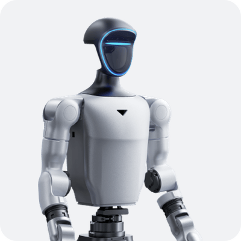</a> <b>Unitree G1</b> 29 DoF ✅</td><td align="center" valign="top"><a href="setup/unitree.md">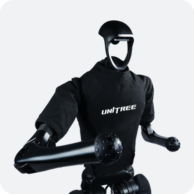</a> <b>Unitree H1</b> 19 DoF ✅</td><td align="center" valign="top"><a href="setup/unitree.md">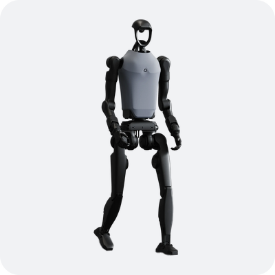</a> <b>Unitree H1-2</b> 27 DoF By Nov 20</td><td align="center" valign="top"> <b>Unitree H2</b> 31 DoF By Nov 20</td><td align="center" valign="top"><a href="setup/fourier.md">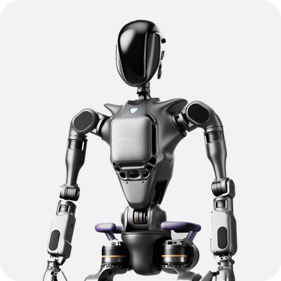</a> <b>Fourier GR1</b> 32 DoF By Nov 12</td></tr>
<tr><td align="center" valign="top">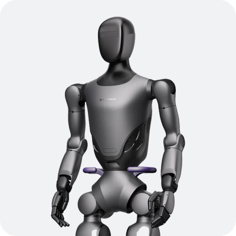 <b>Fourier GR2</b> 29 DoF By Nov 20</td><td align="center" valign="top"><a href="setup/agibot_x1.md">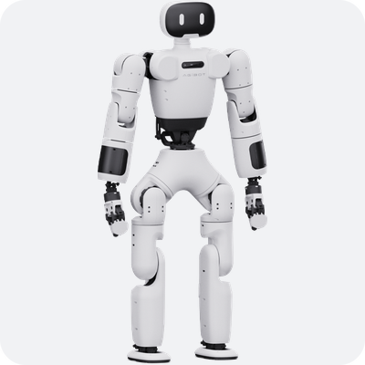</a> <b>AgiBot X1</b> 29 DoF By Nov 20</td></tr>
<tr><td colspan="5"><b>Dual arms on a wheeled base</b></td></tr>
<tr><td align="center" valign="top"><a href="setup/agibot_g1.md">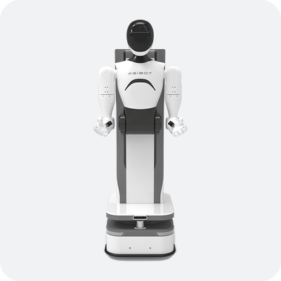</a> <b>AgiBot G1</b> 18 DoF ✅</td><td align="center" valign="top">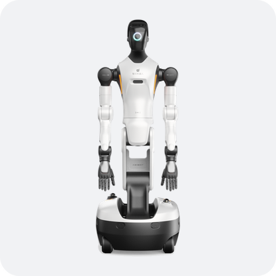 <b>AgiBot G2</b> 22 DoF By Nov 20</td><td align="center" valign="top">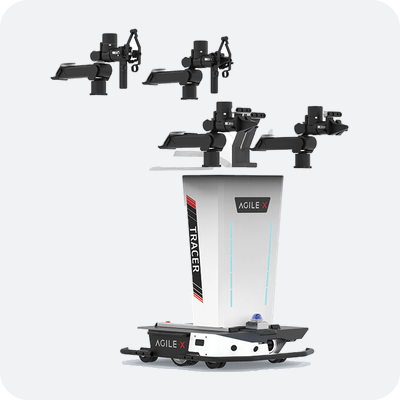 <b>AgileX ALOHA</b> 12 DoF By Nov 12</td></tr>
<tr><td colspan="5"><b>Arms</b></td></tr>
<tr><td align="center" valign="top"><a href="setup/franka.md">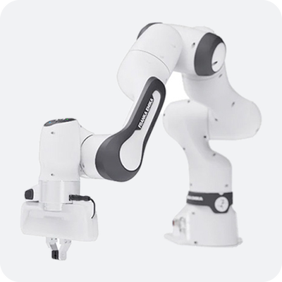</a> <b>Franka FR3</b> 7 DoF By Nov 12</td><td align="center" valign="top"><a href="setup/ur.md">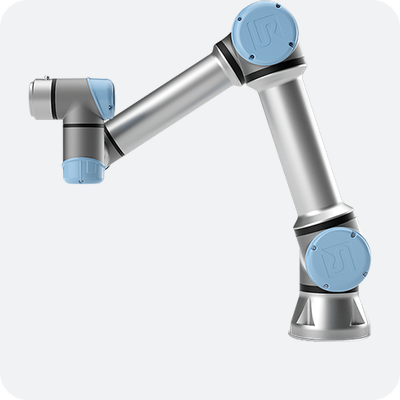</a> <b>UR5e</b> 6 DoF ✅</td><td align="center" valign="top">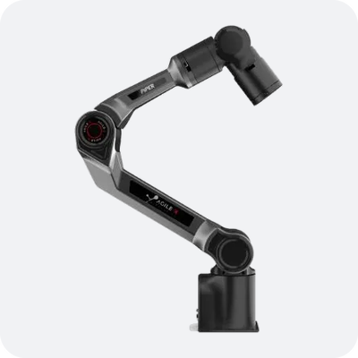 <b>AgileX PiPER</b> 6 DoF By Nov 12</td><td align="center" valign="top">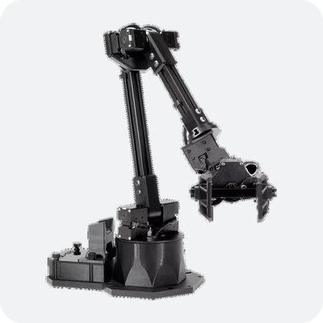 <b>WidowX 250S</b> 6 DoF By Nov 20</td></tr>
<tr><td colspan="5"><b>Hands and grippers</b></td></tr>
<tr><td align="center" valign="top"><a href="setup/unitree.md#dex3-hands-g1">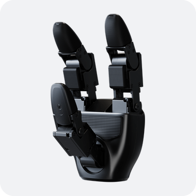</a> <b>Unitree Dex3-1</b> 7 DoF hand, on Unitree G1 ✅</td><td align="center" valign="top"><a href="setup/unitree.md#inspire-hands-h1">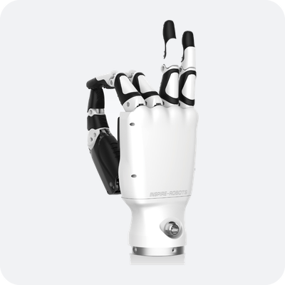</a> <b>Inspire RH56DFX</b> 6 DoF hand, on Unitree H1 ✅</td><td align="center" valign="top"><a href="setup/agibot_g1.md#4-observation-and-action">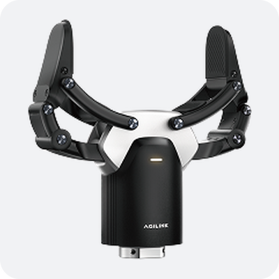</a> <b>AgiBot OmniPicker</b> Gripper, on AgiBot G1 ✅</td><td align="center" valign="top"><a href="setup/ur.md#8-gripper-robotiq-2f">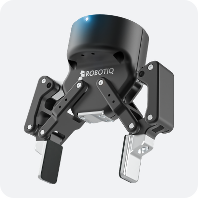</a> <b>Robotiq 2F-85</b> Gripper, on UR arms ✅</td></tr>
<tr><td colspan="5"><b>Cameras</b></td></tr>
<tr><td align="center" valign="top"><a href="setup/unitree.md#head-camera-g1">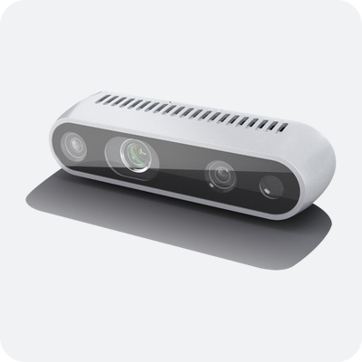</a> <b>RealSense D435i</b> Head, Unitree G1 / H1 ✅</td><td align="center" valign="top"><a href="setup/agibot_g1.md#3-configuration">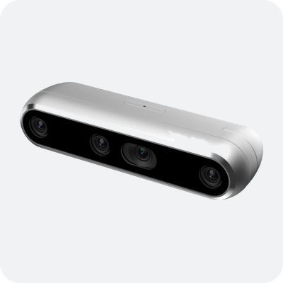</a> <b>RealSense D457</b> Head, AgiBot G1 ✅</td><td align="center" valign="top"><a href="setup/agibot_g1.md#3-configuration">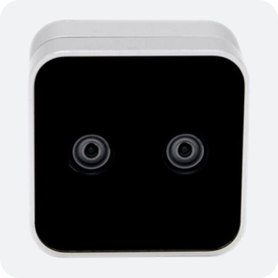</a> <b>RealSense D405</b> Wrist, AgiBot G1 ✅</td><td align="center" valign="top"><a href="setup/ur.md#l515">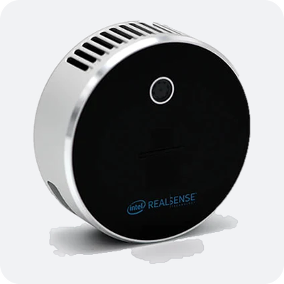</a> <b>RealSense L515</b> Lidar depth, any robot ✅</td></tr>
</table>
<!-- hardware-wall:end -->

### Robot bodies

| Robot | DoF | Configs | Driver | Vendor SDK | Setup guide | Hardware-verified |
| --- | --- | --- | --- | --- | --- | :---: |
| Unitree G1 | 29 | `unitree_g1` | `unitree_sdk2` | unitree_sdk2py | [unitree.md](setup/unitree.md) | ✅ |
| Unitree H1 | 19 | `unitree_h1` | `unitree_sdk2` | unitree_sdk2py | [unitree.md](setup/unitree.md) | ✅ |
| Unitree H1-2 | 27 | `unitree_h1_2` | `unitree_sdk2` | unitree_sdk2py | [unitree.md](setup/unitree.md) | By Nov 20 |
| Unitree H2 | 31 | `unitree_h2` | `unitree_sdk2` | unitree_sdk2py | [unitree.md](setup/unitree.md) | By Nov 20 |
| Fourier GR1 | 32 | `fourier_gr1t2` | `fourier_grx` | fourier-grx-client | [fourier.md](setup/fourier.md) | By Nov 12 |
| Fourier GR2 | 29 | — | — | fourier_aurora_client | — | By Nov 20 |
| AgiBot G1 | 18 | `agibot_g1` | `agibot_gdk` | GDK topics (cosine_bus) | [agibot_g1.md](setup/agibot_g1.md) | ✅ |
| AgiBot G2 | 22 | — | — | agibot_gdk (GDK 2.1) | — | By Nov 20 |
| AgiBot X1 | 29 | `agibot_x1` | `agibot_aimrt` | ROS2 bridge to AimRT | [agibot_x1.md](setup/agibot_x1.md) | By Nov 20 |
| AgileX ALOHA | 12 | — | — | pyAgxArm | — | By Nov 12 |
| AgileX PiPER | 6 | — | — | pyAgxArm | — | By Nov 12 |
| Franka FR3 | 7 | `franka_fr3` | `franka_libfranka` | pylibfranka | [franka.md](setup/franka.md) | By Nov 12 |
| UR5e | 6 | `ur_ur5e`, `ur5e_dual` | `ur_rtde` | ur_rtde | [ur.md](setup/ur.md) | ✅ |
| WidowX 250S | 6 | — | — | dynamixel_sdk | — | By Nov 20 |

Joint names and ordering in each config come from the vendor SDK, so they line
up 1:1 with the hardware. Robot differences live in config and hardware
differences in the driver: the four Unitree configs share one `unitree_sdk2` driver.

### Mobile bases

A wheeled base is driven by its body's driver and commanded with
`BASE_VELOCITY` (`[vx, vy, wz]`, m/s and rad/s); its odometer fills
`Observation.base_position` / `base_orientation`.

| Base | Under | Configs | Driver | Transport | Commands | Setup guide | Hardware-verified |
| --- | --- | --- | --- | --- | --- | --- | :---: |
| AgiBot G1 chassis | AgiBot G1 | `agibot_g1` with `chassis_host` | `agibot_gdk` (body driver) | HTTP + WebSocket to the chassis controller box | `[vx, 0, wz]`, in soft-manual mode only | [agibot_g1.md](setup/agibot_g1.md#2-power-on-and-safety) | ✅ |

### End effectors

A dexterous hand, or a gripper with an SDK of its own, has its own end-effector
driver, attached to a body through the `driver:` key of an `end_effectors` entry
in the config; each hand config below is a body plus both hands. A hand lists its
joints and is commanded through `joint_target`. A gripper lists none and is read
and commanded through `Observation.gripper` / `Action.gripper` (0 closed, 1 open),
in any control mode. A gripper the body's own SDK drives has no `driver:` key, and
the body driver handles `gripper` itself.

| End effector | DoF each | Mounts on | Configs | Driver | Interface | Vendor SDK | Setup guide | Hardware-verified |
| --- | --- | --- | --- | --- | --- | --- | --- | :---: |
| Unitree Dex3-1 | 7 | Unitree G1 | `unitree_g1_dex3` | `unitree_handcmd` | `joints` | unitree_sdk2py | [unitree.md](setup/unitree.md#dex3-hands-g1) | ✅ |
| Inspire RH56DFX | 6 | Unitree H1 | `unitree_h1_inspire` | `unitree_motorcmds` (h1_inspire_service 1.0.1) or `inspire_sdkpy` | `joints` | unitree_sdk2py | [unitree.md](setup/unitree.md#inspire-hands-h1) | ✅ |
| AgiBot Omnipicker gripper (×2) | 1 | AgiBot G1 | `agibot_g1` | `agibot_gdk` (body driver) | `gripper` | GDK topics (cosine_bus) | [agibot_g1.md](setup/agibot_g1.md#4-observation-and-action) | ✅ |
| Robotiq 2F-85 | 1 | UR arms | `ur_ur5e_robotiq` | `robotiq_urcap` | `opening` | none (UR URCap socket, port 63352) | [ur.md](setup/ur.md#8-gripper-robotiq-2f) | ✅ |

### Cameras

A camera is a `cameras` entry in the config with a `driver:`; with a real body
driver, each frame lands in `Observation.images[<name>]`. Sources only read, so
they also run in `read_only`. Stand-ins for tests and
simulation (`video_file`, `array`) are in [api.md](api.md#extension-points-cameras-end-effectors-and-audio).

| Camera | On | Configs | Source | Transport | Setup guide | Hardware-verified |
| --- | --- | --- | --- | --- | --- | :---: |
| RealSense D435i / D405 (any role) | plugged into the hiRobot computer | `intel/d435i_realsense` | `intel_realsense` | pyrealsense2, local USB; colour + depth aligned to colour | [ur.md](setup/ur.md#7-realsense-camera-optional) | ✅ (D435i) |
| RealSense L515 (any role) | plugged into the hiRobot computer | `intel/l515_realsense` | `intel_realsense` | pyrealsense2 2.54.2, local USB; colour + depth aligned to colour | [ur.md](setup/ur.md#l515) | ✅ |
| RealSense D435i (head) | Unitree G1 | `unitree_g1`, `unitree_g1_dex3` | `unitree_videohub` | unitree_sdk2py videohub (`videohub_pc4` on PC2) | [unitree.md](setup/unitree.md#head-camera-g1) | ✅ |
| RealSense D435i (head) | Unitree H1 | `unitree_h1`, `unitree_h1_inspire` | `unitree_image_server` | JPEG over ZeroMQ (Unitree `image_server`, or `scripts/camera_image_server.py`) | [unitree.md](setup/unitree.md#head-camera-h1) | ✅ |
| RealSense D457 (head) | AgiBot G1 | `agibot_g1` | `agibot_cosine` | cosine_bus topics on the robot's computer | [agibot_g1.md](setup/agibot_g1.md#3-configuration) | ✅ |
| RealSense D405 (wrist, ×2) | AgiBot G1 | `agibot_g1` | `agibot_cosine` | cosine_bus topics on the robot's computer | [agibot_g1.md](setup/agibot_g1.md#3-configuration) | ✅ |

## Sim robots

A MuJoCo robot runs the same `Robot` interface, safety gate and `layers:` as
the real one, with names, joint order and cameras taken from the real robot's
config. It is used in two ways:

| Use | How | Real robot |
| --- | --- | --- |
| On its own | A `*_mujoco` config (`unitree_g1_mujoco`, `unitree_g1_mujoco_standing`, `unitree_g1_dex3_mujoco`), or your config plus a `sim/mujoco/...` overlay | None |
| Rehearsal | [`examples/rehearse_in_sim.py`](../examples/rehearse_in_sim.py): read the real robot's pose once, start a `*_mujoco` robot from it with `set_state`, and run the motion there before it is sent | Read-only |

The models are not shipped; the G1 MJCF is fetched from Unitree's
[unitree_ros](https://github.com/unitreerobotics/unitree_ros/tree/master/robots/g1_description)
([commands](setup/unitree.md#5-mujoco-g1-optional)). The dependency-free
`toy` driver, which every shipped config defaults to, integrates joint targets
in-process for tests.
