# 支持的机器人

[English](./supported_robots.md) | 简体中文

仿真器和硬件是同一 `Robot` 接口约定背后的不同驱动，所以一套控制栈只需换驱动就能从仿真转到真机。
仿真器和厂商 SDK 都在各自的驱动内部延迟 import；核心从不依赖它们。

- [真机](#真机)
  - [图片](#图片)
  - [机器人本体](#机器人本体)
  - [移动底盘](#移动底盘)
  - [末端执行器](#末端执行器)
  - [摄像头](#摄像头)
- [仿真机器人](#仿真机器人)

## 真机

每台机器人都有一份 embodiment 配置和一个厂商驱动。随附的配置默认使用 `toy` 驱动；按设置指南
把机器人配置好之后，再设置 `body.driver`。✅ 表示驱动已在真机上运行过。其余的标日期（“11 月 12 日前”、
“11 月 20 日前”）：驱动已有测试覆盖但尚未在硬件上运行，或机器人还没有驱动，计划在该日期（2026 年）前完成。

### 图片

点击图片打开对应的设置指南。

<!-- hardware-wall:start -->
<table>
<tr><td colspan="5"><b>人形机器人</b></td></tr>
<tr><td align="center" valign="top"> <b>Unitree G1</b> 29 自由度 ✅</td><td align="center" valign="top"><a href="setup/unitree.zh-CN.md">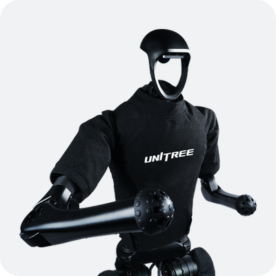</a> <b>Unitree H1</b> 19 自由度 ✅</td><td align="center" valign="top"><a href="setup/unitree.zh-CN.md">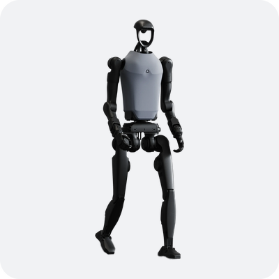</a> <b>Unitree H1-2</b> 27 自由度 11 月 20 日前</td><td align="center" valign="top"> <b>Unitree H2</b> 31 自由度 11 月 20 日前</td><td align="center" valign="top"><a href="setup/fourier.zh-CN.md">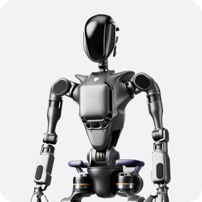</a> <b>Fourier GR1</b> 32 自由度 11 月 12 日前</td></tr>
<tr><td align="center" valign="top">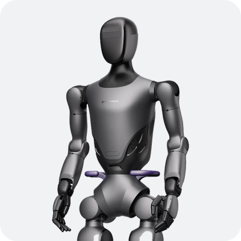 <b>Fourier GR2</b> 29 自由度 11 月 20 日前</td><td align="center" valign="top"><a href="setup/agibot_x1.zh-CN.md">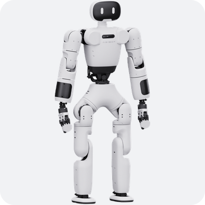</a> <b>AgiBot X1</b> 29 自由度 11 月 20 日前</td></tr>
<tr><td colspan="5"><b>轮式双臂</b></td></tr>
<tr><td align="center" valign="top"><a href="setup/agibot_g1.zh-CN.md">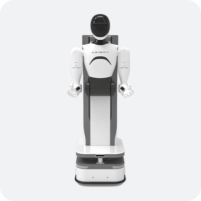</a> <b>AgiBot G1</b> 18 自由度 ✅</td><td align="center" valign="top">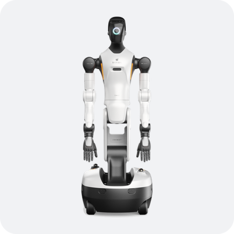 <b>AgiBot G2</b> 22 自由度 11 月 20 日前</td><td align="center" valign="top">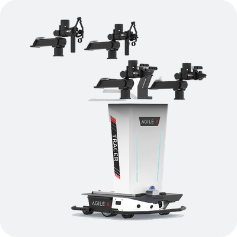 <b>AgileX ALOHA</b> 12 自由度 11 月 12 日前</td></tr>
<tr><td colspan="5"><b>机械臂</b></td></tr>
<tr><td align="center" valign="top"><a href="setup/franka.zh-CN.md">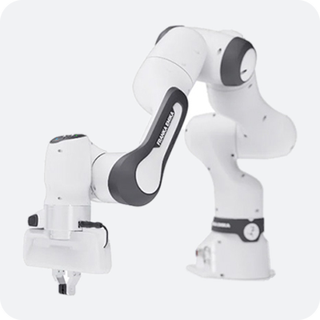</a> <b>Franka FR3</b> 7 自由度 11 月 12 日前</td><td align="center" valign="top"><a href="setup/ur.zh-CN.md">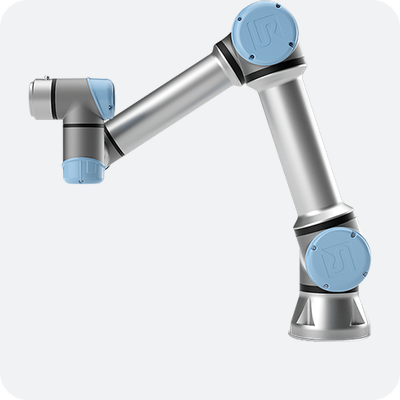</a> <b>UR5e</b> 6 自由度 ✅</td><td align="center" valign="top">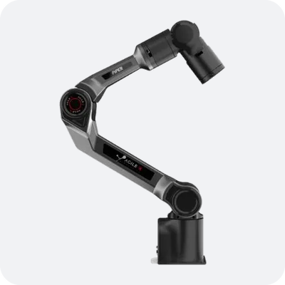 <b>AgileX PiPER</b> 6 自由度 11 月 12 日前</td><td align="center" valign="top">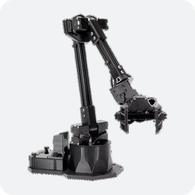 <b>WidowX 250S</b> 6 自由度 11 月 20 日前</td></tr>
<tr><td colspan="5"><b>灵巧手与夹爪</b></td></tr>
<tr><td align="center" valign="top"><a href="setup/unitree.zh-CN.md#dex3-灵巧手g1">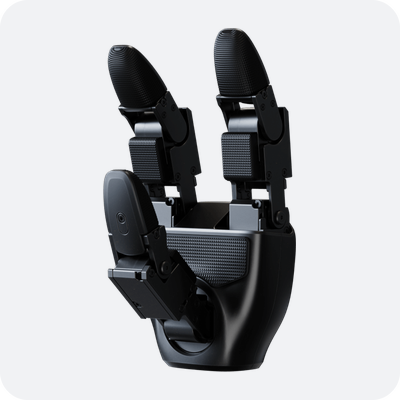</a> <b>Unitree Dex3-1</b> 7 自由度灵巧手，用于 Unitree G1 ✅</td><td align="center" valign="top"><a href="setup/unitree.zh-CN.md#inspire-灵巧手h1">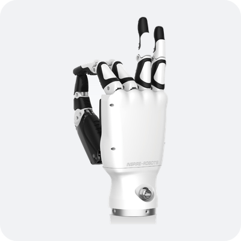</a> <b>Inspire RH56DFX</b> 6 自由度灵巧手，用于 Unitree H1 ✅</td><td align="center" valign="top"><a href="setup/agibot_g1.zh-CN.md#4-观测与动作">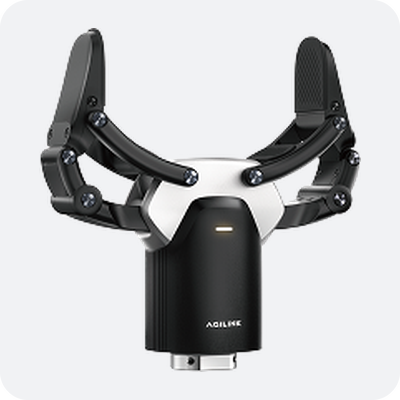</a> <b>AgiBot OmniPicker</b> 夹爪，用于 AgiBot G1 ✅</td><td align="center" valign="top"><a href="setup/ur.zh-CN.md#8-夹爪robotiq-2f">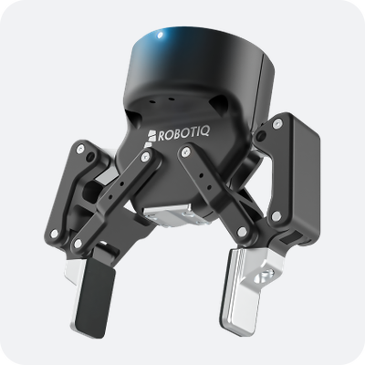</a> <b>Robotiq 2F-85</b> 夹爪，用于 UR 机械臂 ✅</td></tr>
<tr><td colspan="5"><b>摄像头</b></td></tr>
<tr><td align="center" valign="top"><a href="setup/unitree.zh-CN.md#头部相机g1">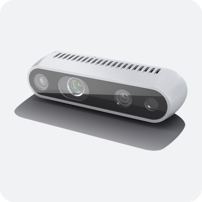</a> <b>RealSense D435i</b> 头部，Unitree G1 / H1 ✅</td><td align="center" valign="top"><a href="setup/agibot_g1.zh-CN.md#3-配置">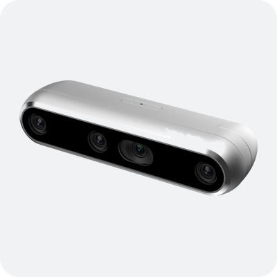</a> <b>RealSense D457</b> 头部，AgiBot G1 ✅</td><td align="center" valign="top"><a href="setup/agibot_g1.zh-CN.md#3-配置">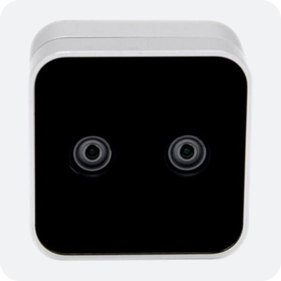</a> <b>RealSense D405</b> 腕部，AgiBot G1 ✅</td><td align="center" valign="top"><a href="setup/ur.zh-CN.md#l515">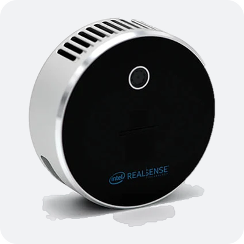</a> <b>RealSense L515</b> 激光雷达深度，任意机器人 ✅</td></tr>
</table>
<!-- hardware-wall:end -->

### 机器人本体

| 机器人 | DoF | 配置 | 驱动 | 厂商 SDK | 设置指南 | 真机验证 |
| --- | --- | --- | --- | --- | --- | :---: |
| Unitree G1 | 29 | `unitree_g1` | `unitree_sdk2` | unitree_sdk2py | [unitree.zh-CN.md](setup/unitree.zh-CN.md) | ✅ |
| Unitree H1 | 19 | `unitree_h1` | `unitree_sdk2` | unitree_sdk2py | [unitree.zh-CN.md](setup/unitree.zh-CN.md) | ✅ |
| Unitree H1-2 | 27 | `unitree_h1_2` | `unitree_sdk2` | unitree_sdk2py | [unitree.zh-CN.md](setup/unitree.zh-CN.md) | 11 月 20 日前 |
| Unitree H2 | 31 | `unitree_h2` | `unitree_sdk2` | unitree_sdk2py | [unitree.zh-CN.md](setup/unitree.zh-CN.md) | 11 月 20 日前 |
| Fourier GR1 | 32 | `fourier_gr1t2` | `fourier_grx` | fourier-grx-client | [fourier.zh-CN.md](setup/fourier.zh-CN.md) | 11 月 12 日前 |
| Fourier GR2 | 29 | — | — | fourier_aurora_client | — | 11 月 20 日前 |
| AgiBot G1 | 18 | `agibot_g1` | `agibot_gdk` | GDK topics (cosine_bus) | [agibot_g1.zh-CN.md](setup/agibot_g1.zh-CN.md) | ✅ |
| AgiBot G2 | 22 | — | — | agibot_gdk (GDK 2.1) | — | 11 月 20 日前 |
| AgiBot X1 | 29 | `agibot_x1` | `agibot_aimrt` | 到 AimRT 的 ROS2 桥接 | [agibot_x1.zh-CN.md](setup/agibot_x1.zh-CN.md) | 11 月 20 日前 |
| AgileX ALOHA | 12 | — | — | pyAgxArm | — | 11 月 12 日前 |
| AgileX PiPER | 6 | — | — | pyAgxArm | — | 11 月 12 日前 |
| Franka FR3 | 7 | `franka_fr3` | `franka_libfranka` | pylibfranka | [franka.zh-CN.md](setup/franka.zh-CN.md) | 11 月 12 日前 |
| UR5e | 6 | `ur_ur5e`, `ur5e_dual` | `ur_rtde` | ur_rtde | [ur.zh-CN.md](setup/ur.zh-CN.md) | ✅ |
| WidowX 250S | 6 | — | — | dynamixel_sdk | — | 11 月 20 日前 |

每份配置中的关节名称和顺序都来自厂商 SDK，所以与硬件一一对应。机器人之间的差异放在配置中，
硬件之间的差异放在驱动中：四份 Unitree 配置共用一个 `unitree_sdk2` 驱动。

### 移动底盘

轮式底盘由其本体的驱动驱动，用 `BASE_VELOCITY`（`[vx, vy, wz]`，单位 m/s 和 rad/s）控制；
它的里程计填充 `Observation.base_position` / `base_orientation`。

| 底盘 | 所属机器人 | 配置 | 驱动 | 传输 | 命令 | 设置指南 | 真机验证 |
| --- | --- | --- | --- | --- | --- | --- | :---: |
| AgiBot G1 底盘 | AgiBot G1 | `agibot_g1`，需设置 `chassis_host` | `agibot_gdk`（本体驱动） | 通过 HTTP + WebSocket 连接底盘控制盒 | `[vx, 0, wz]`，仅在软手动模式下 | [agibot_g1.zh-CN.md](setup/agibot_g1.zh-CN.md#2-上电与安全) | ✅ |

### 末端执行器

灵巧手，以及有自己 SDK 的夹爪，各有一个末端执行器驱动，通过配置中 `end_effectors` 条目的
`driver:` 键挂接到本体上；下面每份手的配置都是一个本体加两只手。手列出它的关节，通过
`joint_target` 控制。夹爪不列关节，通过 `Observation.gripper` / `Action.gripper`（0 为闭合，
1 为张开）读取和控制，任何控制模式下都可以发。由本体自身 SDK 驱动的夹爪没有 `driver:` 键，
`gripper` 由本体驱动自己处理。

| 末端执行器 | 每只 DoF | 安装在 | 配置 | 驱动 | 接口 | 厂商 SDK | 设置指南 | 真机验证 |
| --- | --- | --- | --- | --- | --- | --- | --- | :---: |
| Unitree Dex3-1 | 7 | Unitree G1 | `unitree_g1_dex3` | `unitree_handcmd` | `joints` | unitree_sdk2py | [unitree.zh-CN.md](setup/unitree.zh-CN.md#dex3-灵巧手g1) | ✅ |
| Inspire RH56DFX | 6 | Unitree H1 | `unitree_h1_inspire` | `unitree_motorcmds`（h1_inspire_service 1.0.1）或 `inspire_sdkpy` | `joints` | unitree_sdk2py | [unitree.zh-CN.md](setup/unitree.zh-CN.md#inspire-灵巧手h1) | ✅ |
| AgiBot Omnipicker 夹爪（×2） | 1 | AgiBot G1 | `agibot_g1` | `agibot_gdk`（本体驱动） | `gripper` | GDK topics (cosine_bus) | [agibot_g1.zh-CN.md](setup/agibot_g1.zh-CN.md#4-观测与动作) | ✅ |
| Robotiq 2F-85 | 1 | UR 机械臂 | `ur_ur5e_robotiq` | `robotiq_urcap` | `opening` | 无（UR URCap socket，端口 63352） | [ur.zh-CN.md](setup/ur.zh-CN.md#8-夹爪robotiq-2f) | ✅ |

### 摄像头

摄像头是配置中带 `driver:` 的 `cameras` 条目；使用真机本体驱动时，每一帧都会进入
`Observation.images[<name>]`。摄像头源只读，所以在 `read_only` 下也能运行。
用于测试和仿真的替身（`video_file`、`array`）见 [api.zh-CN.md](api.zh-CN.md#扩展点相机末端执行器与音频)。

| 摄像头 | 所在机器人 | 配置 | 源 | 传输 | 设置指南 | 真机验证 |
| --- | --- | --- | --- | --- | --- | :---: |
| RealSense D435i / D405（任意位置） | 直接插在跑 hiRobot 的计算机上 | `intel/d435i_realsense` | `intel_realsense` | pyrealsense2，本地 USB；彩色 + 对齐到彩色的深度 | [ur.zh-CN.md](setup/ur.zh-CN.md#7-realsense-相机可选) | ✅（D435i） |
| RealSense L515（任意位置） | 直接插在跑 hiRobot 的计算机上 | `intel/l515_realsense` | `intel_realsense` | pyrealsense2 2.54.2，本地 USB；彩色 + 对齐到彩色的深度 | [ur.zh-CN.md](setup/ur.zh-CN.md#l515) | ✅ |
| RealSense D435i（头部） | Unitree G1 | `unitree_g1`, `unitree_g1_dex3` | `unitree_videohub` | unitree_sdk2py videohub（PC2 上的 `videohub_pc4`） | [unitree.zh-CN.md](setup/unitree.zh-CN.md#头部相机g1) | ✅ |
| RealSense D435i（头部） | Unitree H1 | `unitree_h1`, `unitree_h1_inspire` | `unitree_image_server` | 基于 ZeroMQ 的 JPEG（Unitree `image_server`，或 `scripts/camera_image_server.py`） | [unitree.zh-CN.md](setup/unitree.zh-CN.md#头部相机h1) | ✅ |
| RealSense D457（头部） | AgiBot G1 | `agibot_g1` | `agibot_cosine` | 机器人计算机上的 cosine_bus topics | [agibot_g1.zh-CN.md](setup/agibot_g1.zh-CN.md#3-配置) | ✅ |
| RealSense D405（腕部，×2） | AgiBot G1 | `agibot_g1` | `agibot_cosine` | 机器人计算机上的 cosine_bus topics | [agibot_g1.zh-CN.md](setup/agibot_g1.zh-CN.md#3-配置) | ✅ |

## 仿真机器人

MuJoCo 机器人运行与真机相同的 `Robot` 接口、安全门和 `layers:`，其名称、关节顺序和摄像头都取自
真机的配置。它有两种用法：

| 用法 | 方式 | 真机 |
| --- | --- | --- |
| 单独运行 | 一份 `*_mujoco` 配置（`unitree_g1_mujoco`、`unitree_g1_mujoco_standing`、`unitree_g1_dex3_mujoco`），或你的配置加一个 `sim/mujoco/...` 覆盖层 | 无 |
| 预演 | [`examples/rehearse_in_sim.py`](../examples/rehearse_in_sim.py)：读取一次真机姿态，用 `set_state` 让一个 `*_mujoco` 机器人从这个姿态起步，动作发出之前先在那里运行 | 只读 |

模型不随包发布；G1 的 MJCF 从 Unitree 的
[unitree_ros](https://github.com/unitreerobotics/unitree_ros/tree/master/robots/g1_description)
获取（[命令](setup/unitree.zh-CN.md#5-mujocog1可选)）。无依赖的 `toy` 驱动是所有随附配置的默认驱动，
它在进程内对关节目标做积分，用于测试。
